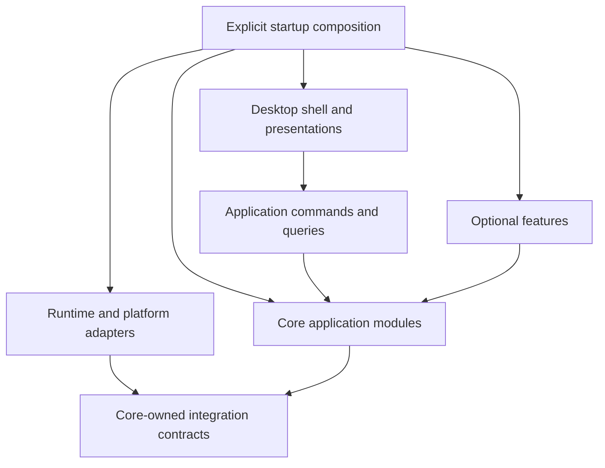

# Architecture

Status: evolving architecture with the headless MVP foundation and desktop UI implemented, updated 2026-10-21.

This document is the architecture entry point required by [AGENTS.md](../AGENTS.md). It captures the agreed product direction and the boundaries used by the implemented headless MVP and desktop UI. Timeline is implemented in part (see [Timeline](timeline.md)); Terminal, Browser and Files are implemented as described in [desktop tools](desktop-tools.md). Background hosting, the remaining timeline phases, retrospective remains follow-on work. Rack-owned orchestration is implemented; see [Agent orchestra](orchestration.md). Concurrent shared and isolated sessions are implemented; see [concurrent sessions](concurrent-sessions.md).

## Product and implementation scope

The product is a desktop agent harness and control panel for coding and general conversations, built around existing agent runtimes. The application owns its user experience, accounts, global sessions, and additional capabilities. The initial integrations are the Codex app server and Claude Agent SDK. Both are first-class runtime adapters behind a shared application contract; adding Pi or another harness should require a new adapter rather than provider-specific changes to core sessions, execution, permissions, or persistence.

Persistent computers, hosted by the product or connected by users, are a future extension. The initial application must work locally without that extension. Future hosting should reuse application behavior through a different host and adapters rather than require extracting rules from UI code.

Implementation proceeds one explicitly approved feature at a time. This document defines responsibility and dependency boundaries; detailed feature policies are refined with the user before implementation.

## Technology decisions and open choices

| Area | Direction | Status |
| --- | --- | --- |
| Product language | TypeScript for application code, adapters, UI behavior, and project tooling where practical | Selected by user |
| Desktop platform | Electron | Selected by user |
| UI library and styling | Framework-free TypeScript renderer with plain CSS, Phosphor icons, bundled Inter, IBM Plex Mono and Geist Mono; see [desktop application](desktop.md) | Selected by user 2026-10-12 |
| Git hooks | Husky | Selected by user; hook policies still to define |
| Package management and development scripts | npm with Node.js tooling | Selected baseline |
| Running desktop application | Electron main for lifecycle and IPC validation; application services in a separate Electron utility process (execution host) | Selected by user 2026-10-12; supervision and background mode remain open |
| Build, packaging, updates, test tooling, storage, supported operating systems | Select when the corresponding foundation work is discussed | Open |

TypeScript describes the source language, not the runtime. Electron provides the desktop shell; the interface still needs web markup, styling, and UI components. Configuration, documentation, and minimal Git hook shell entry points use their appropriate formats.

### Application runtime and development tooling

Electron's main process runs in a Node.js environment, its renderers display web content, and its utility processes also run Node.js. A preload bridge connects the interface to privileged application operations. These are Electron's process boundaries; choosing a package manager does not replace them. See [Electron's process model](https://www.electronjs.org/docs/latest/tutorial/process-model).

Use npm for dependency management and project scripts, with Node.js development tooling. The repository is an npm-workspaces monorepo; see [Repository layout and package boundaries](#repository-layout-and-package-boundaries). Compile application TypeScript for the selected Electron version. Keep application rules independent of Electron APIs and put platform-specific operations behind interfaces.

Pin tooling and dependency versions when the scaffold is approved, commit the npm lockfile, and use reproducible installs in CI. Development Node.js and Electron's embedded Node.js may differ; validate production code against the shipped Electron environment.

Before adopting the build setup, verify dependency installation, required package install scripts, native dependencies, and a packaged Electron launch. Passing headless unit tests alone does not establish Electron compatibility. The desktop-tool smoke checks now exercise Chromium views and local/Codex PTYs on the development machine; a packaged distribution launch remains unverified.

### Husky's role

Husky manages local Git hooks. Git remains the version control system. Proposed hooks should invoke project checks for branch naming, formatting, types, and relevant tests; exact checks and placement remain open. Keep substantial custom checking logic in TypeScript with minimal shell wrappers. See [Husky getting started](https://typicode.github.io/husky/get-started.html).

Local hooks can be disabled, so mandatory checks should also run in CI when CI is introduced. Automated checks support review of architecture, documentation, comments, attribution, and emoji rules; they do not replace that review. Git and Husky have not been initialized in this directory.

## Architectural approach

Use an explicitly assembled, modular application. Logical module boundaries do not require a separate process or package for every feature. Start with the smallest structure that enforces ownership, and introduce additional deployment boundaries only when justified.

1. Group application code by capability rather than global folders of controllers, services, and repositories.
2. Give each module a small public interface. Call operations such as account selection rather than mutating another module's state.
3. Keep rules independent of UI, Electron, provider SDKs, and storage implementations.
4. Supply external dependencies through narrow interfaces owned by the consuming capability.
5. Assemble concrete implementations in explicit startup code. Avoid import-time registration, global service locators, and hidden dependency discovery.
6. Keep the dependency graph acyclic. Cross-module workflows belong in the application coordinator responsible for that workflow.

## Core, optional features, and adapters

Core capabilities are mandatory parts of the product. They remain modular and separately understandable even though they cannot be disabled. Optional features build on the core without becoming dependencies of it. Adapters provide concrete implementations of external integration boundaries; an adapter is not itself synonymous with an optional feature.

Proposed ownership:

| Module | Owns | Boundary |
| --- | --- | --- |
| Authentication | Credential references, authentication lifecycle, access to credential storage | Other modules request authenticated access without reading secrets directly |
| Connections | The "Connect <provider> account" sign-in workflow | Coordinates provider sign-in connectors (adapters) with Accounts and the runtime-context resolver through their public interfaces |
| Accounts | Account identities, availability, selection, and switching policy | Provider-specific authentication and quota observations arrive through explicit interfaces |
| Sessions | Application session identity, conversation history, continuation context, and native session associations | Runtime session IDs are associations, never the global session identity |
| Execution | Run lifecycle, cancellation, recovery coordination, and execution records | Coordinates accounts, sessions, and runtimes through their public interfaces |
| Projects | Selected folder identity, session context, execution path, and editing-run ownership | All consumers use one project ID; platform access is supplied through adapters |
| Timeline | Per-session observed repository snapshots, their checkpoint index, and read-only existing project history | Consumes project paths, sessions and project lock state through a narrow port and observes runs through the host; owns its own store and hidden Git refs; never owns session execution |
| Retrospective | Post-run analysis and environment observations with provenance and validity | Contributes guidance through an explicit optional input; execution works without it |
| Orchestration | User-defined workflows and stage assignments across models/providers | Calls the same execution services used by a single interactive run |

A project and a project workspace are the same product concept: the selected folder and its sessions. Standalone chats have a private file workspace supplied by Sessions, without a Project record. The application has one `ProjectRecord`, one `ProjectsService`, and one `projectId` used by sessions, runs, model discovery, and writer locks. The UI consistently calls this entity a project; there is no second folder record or parent/child identity.

The first six rows describe the implemented foundational modules. Timeline is the first implemented optional feature (phase 1, `packages/features/src/timeline/`). Connections sits above Accounts and Authentication so the dependency graph stays acyclic: Accounts depends on Authentication's credential types, and Connections depends on both.

By default, connected accounts use private contexts with the `native_login` credential method: the provider keeps the credential in its own login store scoped to the account's private runtime-context directory (`auth.json` under `CODEX_HOME`, or the macOS Keychain entry keyed to `CLAUDE_CONFIG_DIR`). The app records only the opaque reference, and `NativeLoginCredentialResolver` resolves it to an empty environment because the runtime adapters already point the provider at that directory. Credential material therefore never passes through application code or records. Timeline, retrospective, and orchestration are optional modules maintained and shipped by the product owner, with on/off controls in settings. Third-party installation is not the intended meaning of optional. Specific adapter boundaries may emerge as integrations are validated.

### Provider diagnostics (2026-10-16)

Connections owns the optional `AccountConnector.diagnose` interface and its
provider-neutral `ProviderDiagnostic` result. `ConnectionsService.diagnose`
validates account/provider ownership, resolves only that account's runtime
context, and coalesces concurrent checks for the same provider/context.
The existing startup composition supplies the connectors; no provider SDK or
protocol enters core. `auth.diagnose` exposes this through validated host IPC.

Provider adapters own executable discovery, bounded local probes and protocol
interpretation. Installation checks create and remove a disposable context;
saved-account checks use the existing private context. No model turn, login,
selection change or availability update is performed. Results contain only
an executable path, parsed version, stage, normalized status/message and time;
raw process output and credentials are excluded. Native providers may maintain
their own runtime files while running these checks. Observations do not establish
network access, subscription entitlement or remaining quota.

The renderer owns transient pending/results state, offers explicit checks in
Accounts settings, and drops saved-account observations after reconnects,
including late replies. No persistence schema changes are required. Codex's
JSON-RPC transport supports opt-in deadlines for startup/control requests;
expiration stops that process and settles pending requests. Long-running
commands and turns have no new deadline.

### Concrete runtime contract

"Provider-neutral" has a strict meaning: core modules may import only application-owned contracts and data types. They must not import Codex app-server protocol names, Claude Agent SDK classes, provider transcript types, provider credential objects, or provider-specific event names. Those imports belong only inside `packages/runtimes/src/codex` and `packages/runtimes/src/claude`.

The implemented shared runtime contract uses these operations and values:

- `RuntimeAdapter.startRun(input)` starts an attempt from application-owned input containing the application session, attempt, project, prompt, selected model, permission mode, and optional native continuation reference.
- `RuntimeAdapter.resumeRun(input)` continues a provider-native attempt when the adapter reports that resume is supported.
- `RuntimeAdapter.cancelRun(attemptId)` requests interruption and reports whether the provider acknowledged it.
- `RuntimeAdapter.describePermissionMode(mode)` returns adapter-owned text describing the native controls used for an application permission mode, so clients disclose the mapping without provider-name conditionals.
- `RuntimeAdapter.capabilities(accountId)` returns explicit support flags for resume, fork, approvals, quota reporting, browser tools, computer use, and other optional behavior.
- The adapter emits normalized application events such as `message_delta`, `thinking_delta`, `tool_request`, `tool_result`, `approval_request`, `usage`, `completed`, `failed`, and `interrupted`.

Interactive questions use a separate provider-neutral `requestQuestions` callback and `question_request`/`question_resolved` events. Execution's `QuestionBroker` owns pending requests, validates answers, journals their lifecycle and settles them on cancellation. The host mirrors pending questions for reconnecting clients and routes `runs.respondToQuestions` to the matching handle. Questions are independent of action permission mode. Claude's `AskUserQuestion` and Codex's `item/tool/requestUserInput` are translated only in runtime adapters; the Codex notification reader stays active while input is pending so native resolution can clear a question. Secret answer values are redacted from normalized question-resolution events while the native callback receives the original value.

Session navigation retains up to eight cached sessions with an approximate 32 MiB payload budget and revalidates saved run versions. Metadata/final messages render before journals finish loading; newer host changes invalidate in-flight loads. The newest 50 run journals load with at most four reads in flight, and earlier pages load on demand. Session summaries project metadata before cloning. Execution uses the indexed append-only log described below; other JSON documents retain their atomic-write behavior.

Session removal belongs to Sessions through `SessionStore.remove` and the host command `sessions.remove`. The host serializes removal, attachment imports and run starts for each session. Ordinary removal rejects tracked or persisted queued/running runs with `session_busy`. Explicitly confirmed `force: true` first cancels and settles that session’s owned run, checks that no queued/running record remains, then removes the saved conversation/continuation record and broadcasts `sessions.removed`. The renderer never silently escalates a busy error: its running-session warning requires a second explicit confirmation when work starts after the original modal opens. Clients evict that session's history cache, discard late metadata/journal/list responses, and clear the chat only when the removed session is selected. Execution audit, attachment retention and Timeline snapshots remain with their existing owners; removal does not purge them or alter project files or provider-owned history. Session/execution schemas are unchanged.

Runtime adapters may also expose a model catalog through the application-owned
`RuntimeModel` contract. The desktop host composes those entries into one
`models.list` response by querying every connected account for that provider.
Catalog entries are deduplicated per provider/runtime/model ID while retaining
the account IDs that reported each model; a failure for one account is
returned as a partial discovery failure instead of hiding another account's
models. Discovery uses the selected project path when one is available and
never starts a model turn. Each model retains its provider and runtime routing
metadata in the host contract, while the renderer presents only the model
name and provider grouping in a compact dropdown, with descriptions in tooltips. Selecting a
model therefore chooses the correct adapter without exposing a Claude/Codex
runtime switch or a free-form model input.

The unified model dropdown (updated 2026-10-14) has no search field or modal
backdrop. It opens above the composer and replaces the model list with the
selected model's discrete reasoning slider and a compact Fast on/off tag.
As of 2026-10-15, Settings > Models owns starring from the full discovered
catalog. `model-favorites.ts` stores per-device routing keys in localStorage;
the renderer store shares those preferences between Settings and the composer.
Only currently available starred entries appear in the composer. Empty or
unavailable favorites never fall back to an unstarred model, and unavailable
keys survive catalog/account changes. Run submission rechecks membership
against current preferences before sending. This is renderer selection policy;
host discovery, provider routing and permission enforcement are unchanged.
`components/model-picker.ts` owns this presentation and exposes an explicit
selection snapshot/setter. The composer retains unsent routing/settings per root
session and initializes from root execution/workflow history. Unavailable
selections survive catalog/favorite changes and require deliberate replacement; `model-settings.ts` validates them against each catalog entry.
The shared popover repositions when the list transforms into the smaller
settings panel, keeping both stages anchored to the same composer control.
The provider-neutral `SpeedOption.fast` flag lets adapters explicitly mark
standard (`false`) and accelerated (`true`) options. The renderer enables
Fast only when both mappings exist and sends their original IDs unchanged.
It never guesses tier semantics from provider IDs or display labels.

Reasoning effort follows the same rule (added 2026-10-14). A `RuntimeModel`
may report `reasoningEfforts` (provider level IDs with optional
descriptions, in provider order) and a `defaultReasoningEffort`. The renderer
offers only those levels for the selected model; `runs.start` carries the
chosen `reasoningEffort`, which execution records on the run and passes to
the adapter in `RuntimeRunInput`. Omitting it means the provider default.
Level IDs are provider values rather than an application enum, because
Codex reports them as free-form strings. The Codex adapter reads
`supportedReasoningEfforts`/`defaultReasoningEffort` from `model/list` and
sends `effort` on each `turn/start`. The Claude adapter reads
`supportedEffortLevels` from `supportedModels()` (Claude reports no
per-model default) and sets the SDK `effort` option, failing the attempt
for a level outside the SDK's `EffortLevel` set rather than silently running
at a different effort.

Speed uses the same shape (added 2026-10-14): `RuntimeModel.speeds`
(`{ id, label, description }`) and `defaultSpeed`, `speed` on `runs.start`,
`RunRecord`, and `RuntimeRunInput`. Speed semantics belong to the provider;
the app only offers reported options and passes the chosen ID back. The
Codex adapter maps `serviceTiers`/`defaultServiceTier` (falling back to the
deprecated `additionalSpeedTiers`), adds Codex's documented `"default"`
standard tier, and sends `serviceTierForTurn` so a turn never rewrites the
thread's tier. The Claude adapter offers Standard/Fast only for models with
`supportsFastMode` and sets the SDK flag setting `fastMode`; plan
eligibility, usage, and cooldown remain Claude's decision.

The Codex adapter translates these operations into app-server initialization, thread, turn, notification, approval, and interruption messages. The Claude adapter translates them into Agent SDK query, session, permission, and streaming operations. Core execution handles the normalized operations and events without checking which provider produced them. A provider-specific feature is exposed as a capability or an explicitly named adapter extension; it is not implemented as a provider-name conditional in core code or the renderer. The concrete implementation and deferred behavior are recorded in [MVP implementation](mvp.md).

The product requires users to bring their own provider subscriptions and requires multiple accounts in the first release. Each saved account therefore has its own provider identity, authentication mode, protected credential reference, runtime configuration context, and availability state. Switching accounts changes which account a new attempt uses; it does not mutate credentials for an active attempt. Concurrent attempts using different accounts must not share credential files, token caches, native session directories, or mutable runtime configuration.

Subscription authentication has documented technical support for both initial runtimes. The Codex app-server documentation describes ChatGPT-managed login and device-code login. Claude documents subscription OAuth tokens for SDK environments, separate account contexts through `CLAUDE_CONFIG_DIR`, account inspection, and subscription rate-limit events. The Agent SDK is intended to embed Claude Code's agent loop in an application, and the product decision is to proceed with that wrapper model using users' own subscriptions. This does not change the requirement to keep credentials and native session state isolated per account. See [runtime integration notes](runtime-integration-notes.md) for the concrete authentication path and isolation behavior.

## Code review and analytics

Pull Requests and Usage are implemented as explicit host services and renderer pages; see [Pull requests and Usage](pull-requests.md). `packages/features/src/pull-requests` owns the public project and account-inbox gateways, project validation and saved-project resolution. The additive `ReviewInboxService` lists and reviews remote PRs independently of local folders; it uses a narrow project-list port only to find exact repository matches for Timeline. `packages/node-adapters/src/code-hosts` owns HTTPS provider APIs, GitHub identities/credential routing, other providers' host-scoped credentials, Git remote discovery, normal branch publishing and isolated review comparison refs. GitHub, GitLab and Bitbucket Cloud share the desktop contract. Provider-specific unsupported controls are disclosed rather than emulated. GitHub has no token entry: new identities are added by browser sign-in, which `GitHubBrowserLogin` delegates to `gh auth login --web` so credentials land in gh's keychain-backed store and persist across restarts without a Rack vault. GitLab/Bitbucket tokens entered in Rack stay in host memory. `GitHubAccounts` discovers every CLI host/user plus independently verified environment identities. Account IDs include host/login, tokens never enter desktop views, and per-user credential subprocesses exclude environmental overrides. `GitHubInbox` binds one credential per operation, fans search across accounts, merges duplicate repository/number identities, and returns partial failures and search-window notices. It never switches global CLI authentication. The renderer shares a tabbed review surface between this inbox and repository workflows.

Timeline reads `refs/rack-pr-timeline/*` through its existing project-history and snapshot membership checks. The review adapter writes immutable merge-base-to-head comparisons, retains prior versions and never changes HEAD, the index or working files. Host freshness events connect the optional capabilities without making either depend on the other's internals.

Usage consumes `ExecutionService.listRunUsage`, a usage-only audit projection excluding prompts, attachments and other journal payloads, with minimal run metadata. It treats observations as cumulative per attempt, displays coverage and never estimates missing cost. Core execution owns the projection and has no dependency on the optional analytics module.

The renderer keeps page navigation separate from session selection. Opening a full main-area page deactivates workbench panels and native browser presentation; closing it returns to the same conversation. The sidebar footer owns icon-only Settings, Usage and Pull Requests destinations; notices are fixed above it at the bottom left.

## Dependency direction and composition

Terminal, Browser and Files (completed 2026-10-15) are explicitly assembled
features under `packages/features/src/`. Files consumes a project lookup and a file
I/O port; its adapter bounds reads and implements version-checked atomic
saves. Terminal owns context-scoped shells and bounded output; native runtime
controls use a core-owned optional port, with `node-pty` as the local fallback.
Both run in the host. Browser consumes a session lookup and driver port;
Electron main owns isolated session-scoped views and the renderer owns their
chrome. Browser commands and session removal share a session mutation lane.
Core modules do not import these features.

Composition contributes Browser through Execution's optional `AppTool`
factory. Adapters configure authenticated run-scoped MCP for fresh/resumed
sessions. Execution owns read-only enforcement and Ask approvals; automatic
modes preserve native review without a Claude allow-list bypass. Cancellation
releases pending approvals before awaiting runtime shutdown, and adapters
close tool listeners on abort/settlement. Native provider shell/file tools
retain their ownership. See [desktop tools](desktop-tools.md) for limits,
retention and validation.

Session attachments (added 2026-10-14) follow the same boundaries. Sessions
owns a provider-neutral `AttachmentStore` port and validates session existence,
batch limits, and file ownership. Startup supplies `DirectoryAttachmentStore`,
which keeps byte-preserving copies and manifests under the data directory,
outside projects. Electron main owns only native multi-file selection;
`sessions.attachFiles` imports selected paths in the execution host. Execution
resolves `runs.start.attachmentIds` before creating a run, saves descriptors on
the run, and includes quoted local file references in the runtime prompt and
conversation history. Existing runtime tools read those files under the chosen
permissions; no provider upload types enter core or renderer code. See
[session file attachments](attachments.md) for limits, draft behavior, and retention.



Arrows describe dependencies or assembly, not event flow. The composition root knows concrete implementations and passes them to consumers. Core code knows contracts, not concrete adapters. The desktop boundary exposes optional feature operations only when those features are assembled.

Use direct typed calls for commands and queries. Use structured events to notify observers about facts that already happened. Do not turn all application control flow into an event bus. Optional observers must not be required for a core operation to complete.

## Repository layout and package boundaries

Implemented 2026-10-22 (branch `refactor/monorepo-workspaces`). The repository is an npm-workspaces monorepo. **Packages** are shared libraries; **apps** are things that run or ship. The move relocated folders and rewrote imports only; application behavior did not change.

```text
packages/
  core/            @rack/core           Domain rules and ports: accounts, authentication, connections,
                                        execution, projects, sessions, session imports
  features/        @rack/features       Optional capabilities: timeline, browser, files, terminal,
                                        orchestration, pull requests, usage
  contracts/       @rack/contracts      Host commands, events, views, validation, desktop transport
  runtimes/        @rack/runtimes       Provider code: codex/, claude/, app-tool-server/, shared/,
                                        authentication/ (connectors, credential and context resolvers),
                                        session-imports/ (native transcript readers)
  node-adapters/   @rack/node-adapters  Node implementations of ports: storage/, git/, worktrees/, pty/,
                                        files/, timeline/ (snapshots, watcher), code-hosts/
  host/            @rack/host           composition/application.ts (createApplication), HostApi,
                                        ActiveRuns, host errors, model cache; integration/ tests
  client/          @rack/client         HostClient plus its transports: the Electron preload bridge
                                        and a resumable WebSocket to a daemon
  ui/              @rack/ui             Framework-free renderer; mount.ts mounts it on any HostClient
apps/
  desktop/         @rack/desktop        Electron main, preload, the host utility-process entry,
                                        build, packaging and native fixture scripts
  daemon/          @rack/daemon         Headless host over WebSocket: config, pairing tokens, ws wiring
  web/             @rack/web            Browser controller: pairing screen, connection banner, bundle
  mobile/          @rack/mobile         Capacitor shell packaging the web bundle for iOS and Android
  vm-manager/      @rack/vm-manager     microVM lifecycle on a bare VPS: create, snapshot, restore
  cloud/           @rack/cloud          Control plane: accounts, billing, provisioning, relay registry
native/tsnet-sidecar/                  Go module: joins a tailnet and forwards to the local daemon
infra/images/                          VM image definitions with the daemon preinstalled
scripts/check-boundaries.ts            Workspace dependency rule check
docs/
```

Previous locations map as follows: `src/core` → `packages/core/src`; `src/features` → `packages/features/src`; `src/contracts/desktop` → `packages/contracts/src`; `src/adapters/{runtimes,authentication,session-imports}` → `packages/runtimes/src`; `src/adapters/{storage,projects,files,terminal,timeline,code-hosts}` → `packages/node-adapters/src` (`projects` became `git` and `worktrees`, `terminal` became `pty`); `src/composition` and `src/desktop/host` → `packages/host/src`, except the Electron entry, which is now `apps/desktop/src/host/entry.ts`; `src/desktop/{main,preload}` → `apps/desktop/src`; `src/desktop/renderer/host-client.ts` → `packages/client/src`; the rest of the renderer → `packages/ui/src`; `scripts/` → `apps/desktop/scripts`. The former library barrel `src/index.ts` is split into `@rack/core`, `@rack/runtimes` and `@rack/host` entry points. Two tests that assemble several layers moved to `packages/host/src/integration/` (`timeline-service.test.ts`, formerly in features; `code-hosts.test.ts`, formerly in adapters) so that no lower package needs a higher one.

### Dependency rules

Dependencies point inward. A workspace may import another workspace only through its package name, and only if it declares it in `package.json`:

| Package | May depend on |
| --- | --- |
| core | nothing |
| features | core |
| contracts | core, features |
| runtimes | core |
| node-adapters | core, features |
| host | contracts, core, features, node-adapters, runtimes |
| client | contracts, features |
| ui | client, contracts, core, features |
| desktop | any package |
| daemon | contracts, host |
| web | client, contracts, ui |
| mobile, vm-manager, cloud | nothing |

Tests and a workspace's `scripts/` may additionally use `devDependencies` (node-adapters tests use contracts and runtimes; desktop fixtures use core, node-adapters and runtimes). `npm run check:boundaries` enforces these rules, the declared-dependency requirement and the ban on relative imports that leave a workspace. It is a small script rather than dependency-cruiser so that the check needs no new dependency.

`contracts` depends on core and features because the wire types reuse domain and feature view types. Making contracts dependency-free requires defining wire-level types separately and is not done yet; clients that must run without core sources (for example a mobile app) will need it.

### Package mechanics

- **Source packages.** Workspace packages export TypeScript sources (`"./*": "./src/*.ts"`, plus explicit entries for module `index.ts` files), so there is no per-package build. `@rack/core/execution` resolves to the module's public index, `@rack/core/execution/types` to a single file. Imports between workspaces are extensionless; relative imports inside a workspace keep `.js` extensions.
- **Type checking.** `tsconfig.base.json` holds the shared Node settings and `tsconfig.browser.json` the DOM/bundler settings used by `ui` and `client` (renderer tests are excluded there, as before). Each workspace has its own `tsconfig.json` and `typecheck` script; the root `npm run typecheck` runs all of them plus the root scripts. A package's program includes the sources it imports from other workspaces. `apps/desktop/scripts` are still not type checked.
- **Tests.** `npm test` runs `tsx --test` over `packages/*/src/**/*.test.ts` and `apps/*/src/**/*.test.ts`. tsx compiles workspace sources because npm links workspaces by symlink and Node resolves the real path outside `node_modules`.
- **Bundling.** Because packages ship sources, esbuild's `packages: "external"` is no longer usable for main and the host. `apps/desktop/scripts/esbuild-workspace.ts` marks every bare import external except `@rack/*`, so workspace code is compiled in while third-party packages that locate files at runtime (Claude Agent SDK, Codex binaries, node-pty) stay external as before. The desktop build writes to `apps/desktop/dist/`.
- **Web and mobile bundling.** `apps/web/scripts/build-web.ts` mirrors the renderer half of the desktop build (same fonts, same inlined SVG icons, same `__APP_VERSION__` define) and emits only browser output; the web controller never loads the host. `apps/mobile` stages that bundle into `www/` for Capacitor, dropping source maps. Build output lives under each app (`apps/desktop/dist`, `apps/desktop/release`, `apps/web/dist`, `apps/mobile/www`) and is ignored by git, so no output outlives the package it came from.
- **Packaging.** npm hoists all third-party packages to the root `node_modules`, so `apps/desktop` has none of its own. `package-desktop.ts` stages a generated manifest (the runtime dependencies of every workspace the app depends on), the build output and a symlink to the root `node_modules`; the packager dereferences and prunes it. The staged manifest keeps the app name `thinking-and-code`, and `apps/desktop/package.json` sets the same `productName`, because Electron derives the user-data directory and single-instance lock from it.

The three new apps that run no agents — `mobile`, `vm-manager` and `cloud` — declare no workspace dependencies at all. `mobile` wraps the *built* web bundle rather than importing it; `vm-manager` and `cloud` are infrastructure and must never reach into the domain. The rule table makes that structural instead of a matter of review.

### Remote protocol and transports

Implemented 2026-10-23. `HostApi` was already transport-independent; what was missing was a second way to reach it. `packages/host/src/transport/` now holds both, and neither adds a dependency to `@rack/host`:

- **`UtilityPortTransport`** serves the host over an Electron utility-process port (`apps/desktop`). Both ends ship together, so there is no negotiation and no resume: a dead port means a dead host. It also carries the browser round-trip to main, bounded by a timeout. The port is typed structurally, so no Electron dependency is introduced.
- **`RemoteHostServer`** serves remote controllers (`apps/daemon`). It owns version negotiation, token authorization, request correlation and replay. It accepts a `HostConnection` — a four-method duplex interface — so the socket library is the daemon's choice and the rules are unit-tested with an in-memory fake.
- **`EventStream`** sequences host events and keeps a bounded replay tail, shared by the remote case.
- **`startHost`** is the startup sequence both processes need: compose, run `execution.initialize()` to completion before serving any command, then begin Timeline tracking in the background. Serving queries first would hand clients stale `running` statuses and writer locks nobody owns.

`packages/contracts/src/protocol.ts` defines the wire format: `hello`/`welcome` carrying `PROTOCOL_VERSION`, request/response by ID, sequenced events, and ping/pong. Mobile apps and remote daemons update on different schedules, so a daemon that cannot speak a controller's version says so in a `rejected` frame instead of failing later on a field it does not understand.

**Resumable sessions.** Each event carries a monotonic sequence; a controller checkpoints the highest it applied and asks to resume from it. A buffered gap is replayed; an evicted one — or a cursor from a previous daemon process, detected through `instanceId` — answers `truncated` and the controller re-reads state with the ordinary read commands. That fallback is always correct because host events are a freshness signal rather than the source of truth, which makes the replay buffer a bandwidth optimization and never a correctness requirement. The same property means the buffer can stay small enough for a 256 MB VM.

**Delivery guarantees.** A command that never reached a socket is queued and sent on the next `welcome`, so the interface issuing commands before the first connection is not treated as an outage. A command that *was* written and then lost its connection is failed with `host_unavailable`, not retried: the daemon may have executed it, and replaying `projects.add` or `sessions.create` would duplicate real state. This matches what a pending command already does when the desktop host process exits. Safe resending would need idempotency keys and daemon-side deduplication, which the protocol does not have.

**Capability honesty.** Folder pickers, "open in editor", revealing a path and the shared browser belong to the machine the *window* runs on. `ClientTransport.shell` is therefore optional and absent on the WebSocket transport, and `HostClient` turns those calls into `feature_unavailable` — an error the interface already handles — rather than letting them fail unpredictably. Browser commands on a daemon answer the same way, because `createApplication` is called without a browser driver.

**Authentication.** The daemon authenticates devices with a 256-bit pairing token, stored `0600` and compared in constant time; `apps/cloud` is what authenticates people. The daemon binds to loopback unless `--host` is passed explicitly, because the intended remote path is the tsnet sidecar or a relay. End-to-end encryption, so a relay sees only opaque blobs, is not implemented.

Within each capability, keep its rules, use cases, interfaces, and tests together. Add internal subdirectories only when useful. Public exports are intentional. Presentation stays grouped by feature inside `@rack/ui`, while application behavior remains in the owning core or feature module.

Contract ownership stays with the relevant module except for transport-specific schemas. A generic shared-types directory must not become a second domain model.

## Desktop and application separation

The Changes surface exposes typed file-status records through Projects
(`ProjectChanges.files` and optional branch), normalized by the Git adapter.
Separate staged and working-tree records preserve partially staged edits;
the renderer receives per-file patches rather than interpreting Git's native
status protocol. `changes-view.ts` renders compact groups and a selected
numbered diff; workbench polling, repository discovery, and writer ownership
keep their existing boundaries. The combined patch stays available for older
clients. Reads do not mutate the index. See [Changes panel](changes-view.md).

Explicit Git operations (2026-10-21) are a separate Projects port,
`ProjectSourceControl`, implemented by `packages/node-adapters/src/git/git-source-control.ts`
and exposed as `projects.sourceControl`. Keeping them apart from the
read-only `ProjectChangesReader` guarantees that background polling can never
mutate a checkout. `ProjectsService.sourceControl` resolves the folder (project,
discovered repository or isolated worktree) from saved records, refuses
branch creation in isolated worktrees, and refuses tree-rewriting operations
(pull, sync, merge, abort merge) while a registered writer edits the same
canonical working tree. During that check it holds the same barrier that branch
checkout uses, so a run cannot start in between. The host emits
`projects.changed` and `timeline.changed` after each operation; Timeline
depends only on those events, not on the Changes implementation.

The implemented desktop process layout, contracts, and renderer structure are described in [desktop application](desktop.md). The execution host runs in an Electron utility process and owns the composed application and all in-flight runs; Electron main validates renderer requests and relays them; the renderer receives serializable views and events through a two-function preload bridge.

The graphical conversation view and terminal presentation must invoke the same application operations. Account switching, session persistence, and recovery are not UI responsibilities. The user's current direction is a terminal presentation of this harness inside the desktop window, not embedding an independent provider CLI. Rendering and terminal libraries remain undecided.

Keep Electron main responsible for lifecycle and desktop integration. Use a narrow preload API with context isolation and validate incoming IPC requests at the privileged boundary. The renderer receives serializable data and explicit operations, not raw IPC access, SDK objects, credentials, or arbitrary privileged execution capabilities.

Implemented 2026-10-16: Windows/Linux menu presentation belongs to the renderer
so it follows the app palette. An allowlisted `windowAction` bridge delegates
native menu effects to main; `windowTheme` accepts validated hex caption colors.
Both require a trusted bundled-page sender. Native caption controls remain owned
by Electron, and macOS retains its system menu. No application rules or host
services depend on this presentation feature. Connection diagnostics are exposed
in an on-demand drawer rather than persistent account cards.

Application modules must run headlessly for testing. Heavy or blocking work must not freeze the interface or main event loop. External agent processes remain behind runtime adapters, with explicit startup, cancellation, exit, and cleanup behavior.

### Execution lifetime and optional background work

The user wants local agents to stop when the harness exits by default, with a confirmation when work is active. They also want an activatable background mode that allows work to continue without open windows and accommodates future relay and remote access.

Proposed structure: the desktop UI connects to an execution host that owns runs, runtime processes, persistence, and pending approvals. Keep that host independent of renderer windows. A separate supervised Node.js host process is the current recommendation; process packaging and supervision are not yet selected.

- Default mode: an intentional harness exit stops owned runs and runtime processes. Persist completed outcomes and mark interrupted work accurately. Confirm before stopping active work; the exact dialog remains open.
- Background mode: closing the UI can leave the execution host running. Reopening the UI reconnects to existing runs instead of starting duplicate agents.
- Provide an explicit stop-all-and-exit operation in either mode. Distinguish closing a window, disconnecting a client, and stopping the execution host. The exact full-quit behavior and labels still need agreement.
- When a run needs user input and no UI is connected, preserve the pending request and wait for an authorized response. Background mode does not grant extra permissions.
- Future remote clients connect to the host that owns the work. A relay transports communication; it does not execute tasks or keep a sleeping local machine working. Host transfer, startup at login, crash restart, and remote authentication remain future design work.

The optional background feature changes host lifetime policy; it must not create a second implementation of sessions or execution. A windowless Electron process may suffice for some local background behavior, but it does not by itself establish an independently operated remote execution service.

## Runtime integration boundaries

Distinguish an agent runtime, a model provider, an account, and a selected model. They are related but not interchangeable identities: one runtime may support several providers and one provider may have several accounts.

Runtime adapters translate native requests, responses, events, errors, and session associations into application contracts. They expose supported capabilities, such as native resume, interruption, or quota reporting, rather than pretending every runtime supports every operation.

Shared operations use common interfaces. Runtime-specific extensions remain explicitly named and discoverable. Do not spread provider-name conditionals through core modules or renderer components.

The application wraps the existing runtimes and should reuse their available execution, browser, and computer-use capabilities. Availability must be verified per integration: a vendor's desktop product may expose features that its SDK does not. Pi's browser and computer-use capabilities remain unverified.

The initial documentation findings are recorded in [runtime integration notes](runtime-integration-notes.md). Account isolation and supported authentication are represented in the implemented adapters; browser reuse, complete cross-runtime context handoff, and distribution-specific authentication still need targeted verification before those features are exposed. The product requirements do not establish that upstream APIs already provide those deferred behaviors.

### Browser ownership

The user wants an app browser for manual browsing and agent access, and would prefer to reuse or manually open a provider browser if a supported integration permits it. Search/fetch tools, controllable browser tabs, and full desktop computer use are separate capabilities.

Implemented 2026-10-15: an app-level browser service exposes a controlled tool interface to runtime adapters. Electron main owns one sandboxed page and in-memory profile per conversation; user controls and authenticated run-scoped MCP tools access that same page. There is no verified provider-browser embedding API in the installed integrations, so the application-owned driver supplies this capability. A future provider driver can implement the same public port if an API supports opening, observing and controlling its browser.

Pages survive hiding the panel, conversation switches and renderer reloads. Pause/Resume is user-owned and applies to all agent actions. Closing the page, removing the conversation and app exit release it; the current stop-on-exit policy also stops runs. Remote placement, durable browser profiles and future background hosting remain open. Website content is isolated from the privileged bridge. See [desktop tools](desktop-tools.md).

### App-owned permission modes

The app owns the selected mode and approve/decline interaction, and adapters translate that policy into supported runtime controls. Requested modes are read only, ask me, approve for me, and full access. Approve for me delegates decisions to the native Codex `auto_review` reviewer or Claude `auto` classifier. The adapters pass explicit permission settings for each run, including resumed sessions, and preserve provider denials. Rack does not implement a separate auto-approval algorithm or fall back to full access. Ask me alone forwards native tool-approval requests into the app broker; read-only enforcement denies attempted mutations at the native boundary.

Read-only enforcement must cover tools that can mutate through commands, browser actions, or external services, not just file-edit tools. Approval callbacks are not necessarily invoked for every tool, so mappings must account for runtime allow rules, hooks, sandboxing, and any stricter upstream restrictions. Full access expresses the user's requested scope within available runtime and host permissions; it cannot override controls outside the app.

Do not silently weaken a mode when switching runtimes. If an adapter cannot enforce the requested policy, report that incompatibility rather than present an unsupported guarantee. Keep approval decisions scoped to the relevant action and attempt so a stale approval cannot authorize unrelated resumed work.

## Sessions, continuity, and records

Global sessions belong to the application and are grouped within projects. One user-facing conversation can be continued by Codex, Claude, or another supported runtime. This does not merge every independent conversation in a project into one transcript. Preserve structured conversation content, project references, execution outcomes, and continuation context independently from native runtime session IDs. Associate each execution attempt with its runtime, account, model, and any native continuation data. Native continuation associations are scoped to the runtime and the account's runtime context, because native IDs resolve only within the isolated store that created them; a session keeps one association per runtime context.

Proposed identities: a session is the ongoing application conversation; a run is a requested unit of work; an attempt is execution using a particular account and runtime. Native Codex threads and Claude SDK sessions remain associated execution state under the application session. Naming and schema are proposals, not finalized contracts.

Cross-runtime continuation is a context handoff, not an assumption that opaque native sessions are interchangeable. Prefer native continuation when supported; otherwise prepare context at the handoff boundary. Do not invent missing tool results or transfer hidden model state.

Track how much of the application conversation each native continuation has seen. For a Codex-to-Claude-to-Codex sequence, the old Codex thread must receive relevant intervening work before continuing. Merely reopening its previous native ID would leave it unaware of Claude's work. Use supported input mechanisms or a fresh native context; do not rewrite opaque runtime transcripts into an invented universal format.

Implemented: `NativeContinuationReference.seenThroughMessageId` records the last session message each native thread has seen. ExecutionService sets it to the run's prompt when the adapter confirms the thread, and to the run's reply when the run settles. Before resuming, it hands the thread only the later messages (other runtimes, accounts and workflow turns) as a quoted, attributed context block followed by the current request. A fresh thread receives the recent conversation the same way. `packages/core/src/execution/handoff.ts` renders both blocks: whole turns within a 60,000-character budget (newest first, omitted turns counted, an oversized newest turn shortened with an explicit notice), each attributed by provider and model, with tool activity and changed files summarized from the run journal. Raw tool messages and readable thinking are excluded, and tool calls are never replayed. Records saved before the marker existed derive their position from attempts that recorded the same native session ID. When the position cannot be established, a fresh thread with full context is used instead of a blind resume.

Adapters report a resumed thread that cannot be opened as `failed` with `reason: "continuation_unavailable"`: Codex "no rollout found" from `thread/resume`, Claude "No conversation found". If that is the first activity of the turn, ExecutionService removes the stale association, journals a `run_status` note and continues the same attempt in a fresh thread with full context. Codex reports a new thread ID only after `turn/start` succeeds, because Codex writes the rollout when the first turn starts; a thread whose first turn failed is no longer saved.

Recovery must distinguish completed actions, failed actions, and actions whose outcome is unknown. A continuation prompt alone cannot guarantee safe replay of an interrupted side effect. Maintain progress during execution so recovery does not require an exhausted account to generate a summary.

Account exhaustion should trigger automatic selection of an eligible same-provider account. If none exists, the user chooses a cross-provider model before continuation. These are product requirements; selection ordering, retry budgets, checkpoints, and ambiguous-action handling remain feature design work. Quota exhaustion and context-window exhaustion are separate conditions.

Use runtime-reported availability and reset information when supplied. Keep any additional tracking behind the account integration boundary. Do not encode unverified assumptions about subscription tiers or limit windows.

Core execution records support continuity independently of timeline. Optional features can build indexes or analyses from those records. Define stable identifiers, ordering within a run, and schema versions when records are implemented. Record only observable runtime information; do not promise traces that an upstream runtime does not expose.

## Project ownership and concurrent work

A session can be a standalone chat with a private working folder, or belong to one project, which identifies the selected project folder. See [Chats, Plan mode and installed skills](chat-plan-skills.md). Sessions and runs refer to the same optional `projectId`; execution rejects a run that names another project or supplies a project for a standalone chat before recording work or acquiring a writer. Switching accounts or handing sequential work from one runtime to another continues in that project. The app permits concurrent sessions while reserving each conversation for one run at a time.

**Concurrency (decided by the user 2026-10-15, replacing "one writer per project folder").** Several sessions of a project may run at once, and each session runs one turn at a time. A session chooses its workspace before its first message:

- **Shared** sessions run in the project folder concurrently. Their edits are not isolated, which is the same behavior as T3 Code's current checkout and Codex's Local mode.
- **Isolated** sessions run in a session-owned Git worktree on a `rack/<id>` branch.

Isolated execution directories are recorded on the project with their branch, base reference, and base commit, so history can attribute changes. They are not a second user-facing project concept. Combining results is explicit: in phase 1, through the branch with ordinary Git. Writer ownership is tracked in memory by the execution host; the persisted lock field is ignored. Projects without Git, and repositories without a commit, cannot isolate. See [concurrent sessions](concurrent-sessions.md).

Composition resolves session execution directories for Files, Terminal, Changes and relative editor links through Projects. PR publishing consults the live writer registry rather than a persisted project lock. The host supplies Execution with an optional `beforeRuntime` preparation callback: worktree setup happens first, then Timeline captures the baseline, then the runtime starts. The returned run handle stays queued during setup and can be cancelled before provider startup. Timeline uses session-level busy checks, and project-wide background tracking continues to observe the main checkout.

New worktrees start from the main checkout's HEAD commit, without uncommitted changes, as in T3 Code and the Codex CLI. Carrying uncommitted changes over (as the Codex app does) remains a possible extension. Tests and review tools may mutate files or external services, so they are not automatically safe to run alongside an editing agent in the same project. Coordination of external editors and changes made outside the app remains a design task; the app should detect relevant drift before applying or merging agent results.

## Persistence and optional feature lifecycle

The execution host is the logical authority for application sessions and run progress. The UI and optional features request changes through public operations; they do not write execution tables or files directly. Each capability owns its persisted data schema and mutations. Storage adapters supply the implementation; the database and migration tooling remain open.

Store both current state for efficient queries and an append-only execution journal for the observed sequence of work. Where a recorded action outcome changes run state, commit those updates together in one storage transaction. A user-facing timeline may index or present the journal, but disabling timeline must not remove the core record needed for continuity and recovery.

Record the requested action, its runtime and account attempt, confirmed outcomes, and uncertain outcomes. A database transaction cannot atomically include an arbitrary shell command, browser submission, or provider operation. If the host crashes after an external action succeeds but before recording success, mark its outcome unknown and investigate before retrying. A checkpoint identifies the last recorded progress and continuation context; it does not restore the entire computer.

Keep native runtime transcripts and identifiers separately for provider-supported resume. Store large outputs, screenshots, and diffs as referenced artifacts instead of loading them with ordinary session history. Keep credentials in protected storage outside conversation and execution records. Retention, backup, encryption, and artifact storage formats remain open.

Version persisted sessions and records, and supply explicit migrations as their schemas evolve. Projects now use `projects.json` schema 4; sessions and execution use schema 4. The project store imports the old project/child-workspace document and `workspaces.json` before its first write, retaining folder IDs as project IDs or aliases to the canonical project when duplicate paths exist. Session and run migrations prefer the old `workspaceId` over any obsolete parent `projectId`, then resolve duplicate folder aliases to the canonical project. Both histories remain under the one folder row. Messages, continuations, attempts, journal entries, outcomes, revisions, and writer ownership remain intact. After migration the canonical documents are authoritative; the legacy `workspaces.json` file is left unchanged, while older projects, sessions, and execution documents are upgraded in place. Keep credentials out of conversation and execution logs. Provider-native payloads should remain scoped and versioned rather than silently becoming universal application data.

Optional features are bundled, first-party modules with settings toggles. They declare their required core capabilities and any optional relationships. Composition validates those dependencies and registers their UI contributions and subscriptions. Disabling a feature removes its contributions and stops its workers without deleting its stored data or breaking basic execution. The behavior of a toggle during active work must be defined per feature. Downloadable plugins, arbitrary third-party code, and runtime code unloading are outside the current scope. Themes and fonts are settings, not a reason to create a plugin system.

Retrospective observations must be associated with the relevant environment and support invalidation or rechecking. A transient browser failure must not permanently declare that browser unavailable on every computer.

## Performance and future computers

Performance is a requirement to measure, not a guarantee implied by modularity. Keep normal execution incremental: stream updates, bound queues, paginate histories, and avoid repeatedly loading or translating entire sessions. Keep optional analysis outside the critical execution path. Durable recovery records need a defined write ordering; a disposable event subscription is insufficient for persistence.

Before setting budgets, measure startup, streaming responsiveness, persistence overhead, memory use, and handoff latency. Check performance in the packaged app as well as development mode.

Keep local project and execution access behind focused platform interfaces. Use explicit environment references where sessions and project operations need them, rather than embedding the assumption of one local computer everywhere. Future remote adapters can introduce transport, remote identity, and connectivity handling. Do not build a generic distributed platform or remote desktop protocol now.

## Verification and evolution

As implementation begins, enforce import boundaries and cycles with tooling. Test meaningful application rules independently of the UI; verify adapter behavior against the contracts it claims to support. Exercise optional feature removal, account isolation, recovery, and cross-runtime handoff when those features are implemented. Electron integration and packaged smoke checks remain necessary alongside headless unit tests.

Before each approved feature, identify its owner, public contracts, dependencies, data changes, and validation. Update this document when those boundaries change and record the change in [changes.md](changes.md). Add focused decision records for consequential choices once they are actually made, rather than pre-generating decisions for speculative features.

## Architectural gaps to resolve before foundational implementation

The following questions affect multiple modules. They are discussion items, not approved implementation decisions. Resolve them progressively, beginning with runtime feasibility and execution ownership.

| Priority | Gap | Decision or evidence needed | Why it matters |
| --- | --- | --- | --- |
| 1 | Runtime feasibility and account isolation | Verify Codex and Claude subscription authentication for a third-party wrapper, required approval status, independent credential/configuration contexts for multiple accounts, quota signals, event access, and resume behavior. Distinguish API credentials from subscription-backed accounts. | BYO subscriptions and multiple accounts are first-release requirements; a generic adapter cannot manufacture unsupported login or isolation behavior. |
| 2 | Execution ownership and lifetime | Default stop-on-exit and optional background execution are requested. Decide host supervision, exact quit behavior, and reconnection protocol. | Determines process supervision, IPC, shutdown, and future remote hosting boundaries. A separate process is not by itself an independent background service. |
| 3 | Session and recovery contract | Agree on session, run, attempt, and checkpoint identities; define canonical recorded content, native continuation data, and ownership of writes. | Affects account handoff, restart recovery, timeline, and orchestration. One logical session must not imply unrestricted concurrent mutation of one conversation. |
| 4 | Execution authority and permissions | Four app-owned modes are requested. Define their exact scopes, the approve-for-me reviewer, runtime mappings, and preservation of pending approvals. | UI modes, runtimes, and account switching must not create inconsistent authority. Do not assume every runtime can route all tools through an app-owned executor. |
| 5 | Project concurrency | Decided 2026-10-15: concurrent shared sessions in the project folder, and isolated sessions in session-owned worktrees, one turn per session (see [concurrent sessions](concurrent-sessions.md)). Still open: merge/apply flows, carrying uncommitted changes into worktrees, detecting external edits, and isolation without Git. | Future orchestration, code attribution, and timeline accuracy depend on this boundary. |
| 6 | Durable storage ownership | Execution host owns application state and an append-only journal; outcome and state updates should be atomic where possible. Select a storage engine, artifact format, migrations, retention, backup, and recovery handling for unknown external outcomes. | The chosen store must make confirmed progress trustworthy without claiming arbitrary tool actions can be rolled back atomically. |
| 7 | Optional feature lifecycle | Scope clarified: bundled first-party modules toggled in settings. Define per-feature behavior when disabling during active work. | Stopping an optional worker must not abandon core runs or delete their history. |
| 8 | Presentation, browsers, and distribution | Interactive Terminal, shared Browser and Files surfaces are implemented (see desktop tools). Separate CLI presentation, remote browsers, initial operating systems and runtime distribution/update policies remain open. | Determines whether interfaces retain core guarantees and whether integrations work in the packaged application. |

Detailed retrospective policies, orchestration editing, timeline presentation, and model-selection UX can wait for their feature discussions. Exact UI, storage, build, and testing libraries should be selected when the corresponding foundation work is approved; those library choices should not substitute for the ownership decisions above.

## Local session import

The user approved discovery of local Codex and Claude sessions for a selected project folder on 2026-10-14. See [local session import](session-import.md) for usage, contracts, and limitations. The Session Imports coordinator consumes read-only native-history sources behind adapters, validates the exact project path, and copies selected conversation/tool history into the Sessions capability. Discovery returns partial source failures; importing the same source/native ID into a project is idempotent. The renderer offers discovery, a conversation preview, and explicit import from the project row.

Imported history is a snapshot, not an active run or an execution journal created by Rack. Native source IDs are recorded as provenance, separate from native continuation associations. Since Rack uses isolated account directories, imported conversations continue in a fresh runtime context with their visible user/assistant history supplied as background. Original transcripts and credentials are not copied or modified. Native resume across account stores, live synchronization, export-file imports, subagent histories, and other providers remain future work. Unsupported attachments are labelled rather than silently presented as copied media. Import does not restore workspace files or grant the original session's permissions.

## Runtime activity presentation

Updated 2026-10-14. Normalized events add optional thinking format/trace identity, tool call IDs and explicit tool output deltas. These fields are application-owned; provider interpretation remains in runtime adapters. Thinking summaries remain distinguishable from readable trace text, and no adapter decodes opaque/encrypted reasoning. Tool output chunks do not imply completion. Correlation uses native IDs when available and retains a legacy fallback for ID-less records.

The renderer retains current-session activity after live runs finish and rebuilds it from the persisted journal on reopen. It uses cached event folds for both active and completed turns. Thinking text is open by default and unlabelled, with the summary/trace distinction kept in the control's accessible name; commands/files get formatted activity cards with targets, status, duration, output and diffs. Unknown data remains inspectable, and unfinished/uncertain actions are not shown as successful. Batch import is a renderer-coordinated series of idempotent host imports, with explicit partial success and retries. Permission labels change presentation only, preserving host enforcement and diagnostic mappings.

## Current project changes

Updated 2026-10-14. Projects exposes `getChanges(projectId)` through the desktop command `projects.changes`. It resolves the saved project folder and delegates to a `ProjectChangesReader` port. Startup composes the read-only `GitProjectChangesReader`; project identity, execution and persistence do not depend on Git preview availability. The adapter reads staged/unstaged differences against HEAD and bounded untracked text previews, scoped to that folder. Repositories without commits use staged plus unstaged patches. Results report ready, non-Git, or unavailable; read errors propagate to the panel. No project files or index entries are mutated.

The Changes surface polls at two-second intervals while visible, serializes reads and rejects replies for a different selected project. It shows current working-tree changes, including edits made before or outside a run; it does not claim agent attribution or persist a diff artifact. Non-Git diffs, filesystem watchers, per-run baselines and large artifact storage remain unimplemented. Response footers contain only timestamps; diagnostic run details move to a separate right-panel surface.

Native permission parameter verification (2026-10-14): Codex CLI 0.162.1 generated protocol bindings expose `approvalsReviewer` on thread start/resume and turn start, with `auto_review` supported. An isolated ephemeral thread-start check returned the requested reviewer and sandbox; no model turn was started. Claude Agent SDK’s installed declarations support `auto`. Provider availability and managed restrictions still govern whether automatic review can execute an action. See [Codex app-server permission parameters](https://developers.openai.com/codex/app-server/) and [Claude SDK permission modes](https://code.claude.com/docs/en/agent-sdk/permissions).

## Optional features: Timeline

Added 2026-10-14. Timeline is the first optional feature module and establishes the pattern for later ones. See [Timeline](timeline.md) for behavior, contracts, and limitations.

- **Location and interface.** `packages/features/src/timeline/` holds the rules and ports; `index.ts` is its public interface. Git, filesystem-watch, and JSON-storage implementations live in `packages/node-adapters/src/timeline/` and `packages/node-adapters/src/storage/json-timeline-store.ts`.
- **Container project resolution (2026-10-15).** The Git snapshot adapter resolves a project inside Git directly, or a non-Git container through the bounded `GitRepositoryDiscovery` adapter shared with Changes. Only a complete, unambiguous single-repository discovery is accepted; its canonical root is checked inside the selected container. History, snapshots, visibility checks and watcher setup use that same resolved root. Project/session identities and pause settings stay unchanged. Ambiguous or incomplete discovery asks the user to open a repository folder; symlinked child directories are not traversed.
- **Dependencies.** The feature depends on core only through `TimelineCoreAccess` (project path without a selected session, session project path, Codex import provenance, project writer-lock state), which composition builds from public `SessionsService`/`ProjectsService` calls. No core module imports Timeline. The feature owns `timeline.json` and the hidden `refs/rack-timeline/<session ID>` refs; it never writes session, execution, or project records.
- **Existing history.** `projectHistory` reads bounded first-parent HEAD history and all Rack/Codex/Relay timeline refs independently of session recording. `projectFileDiff` accepts only a currently reachable commit and visible changed path from that project's history. Ordinary root commits compare against an empty tree; snapshot baselines stay hidden. Immutable commit comparisons use a bounded cache, while current ignore rules are evaluated per query. These reads do not persist a session index or alter opt-in.
- **Automatic project observation (2026-10-15).** The desktop host explicitly starts/stops `ProjectTimelineTracker` through Timeline. It discovers saved projects through the narrow `TimelineCoreAccess.projects` read, coalesces observations per repository root, watches edits outside runs and uses a five-second fallback when watching is unavailable. Newly registered projects request reconciliation. Initial changes compare against HEAD when no project chain exists; observations own `refs/rack-project-timeline/<project ID>`. Project Pause/Resume persists in an additive schema-1 `timeline.json.projects` field; missing settings default on. Session capture remains independently opt-in. Shutdown stops observers alongside run cancellation, and headless readers never start workers implicitly.
- **Historical viewer (2026-10-15).** Timeline owns `snapshot`, `snapshotFile` and `snapshotHistory`: a visible before/after file union, exact lazy blob reads, scoped diffs and validated same-project navigation targets. The Git adapter lists immutable trees and reads regular blobs by object ID; it never checks out files or follows symbolic links. Contents are bounded at 1 MiB. Electron main validates `openTimelineWindow` through the host and opens only the bundled sandboxed page with app identities in its query. Renderer bootstrap mounts `features/snapshot-window.ts` instead of chat. The window owns its change dropdown, file tree/filter and **Diff**, **Before / After** (split), and **Full context** dropdown independently. Snapshot/file generations discard stale loads during navigation; refreshing the history list does not move the selected comparison. `snapshot-context.ts` reconstructs context only from complete patches. No core records change.
- **Composition.** `createApplication` assembles Timeline by default and omits it with `timeline: false`. `HostApplication.timeline` is optional. Without it, `timeline.*` commands answer `feature_unavailable` and runs are unaffected.
- **Run observation.** Execution is unchanged. The host coordinates the cross-module workflow: `runs.start` asks Timeline for a run observer *before* `execution.start`, so the run-start snapshot precedes runtime edits. `ActiveRuns` feeds each normalized event to the observer and finishes it after `run.finished`. Observer calls are guarded, so Timeline can never delay, reorder, or fail a run, and a Timeline failure never blocks one.
- **Toggle ownership (open).** Settings controls surface visibility. Project observation uses host-owned per-project Pause/Resume, while session run chains use their own opt-in. Hiding the surface does not stop either. A global host-owned plugin toggle remains separate work.

The Timeline renderer exposes Projects' existing bounded repository discovery when a container folder is unsupported. Folder choices reuse or register normal project identities and host tracking through `registerProject`, then change only Timeline's in-memory query target. The selected chat project/session, messages and composer draft stay in place. A repository context label and Back to project action identify that local view; actual chat project changes reset it. This avoids clearing the chat when browsing a nested repository. Discovery replies are generation-guarded. The historical viewer adds a visible change selector, position counter and bounded newer/older buttons over the existing validated `snapshotHistory` targets; no host contract changes are required.

## Execution recovery and bounded shutdown (2026-10-16)

Before desktop host readiness or any new run, `ExecutionService.initialize()` performs one startup reconciliation. The execution store atomically changes abandoned queued/running runs and attempts to `unknown` and appends recovery status records; completed outcomes, native continuation IDs and streamed journals are preserved. Projects then clears legacy previous-host writer locks, including locks whose attempts were never saved. The desktop acquires an Electron instance lock so another launch of the same profile focuses the existing owner instead of recovering its live runs. Headless embedders must likewise use one live owner per metadata directory. Initialization is idempotent within a host.

Cancellation races stream reads against abort, ignores late events and bounds native acknowledgments. Runtime adapters expose optional owned-process `forceCancel`; Codex tracks startup processes before a thread exists, and its JSON-RPC transport rejects pending requests and terminates its POSIX process group on close. Claude closes its owned SDK query. Core waits for native cleanup and bounded iterator cleanup before releasing the project writer and persisting interruption. A final persistence error still closes the event queue and leaves the UI with an uncertain outcome rather than permanent loading.

Shutdown begins cancellation immediately, rejects queued/late starts, drains session mutations and applies its timeout to the cancellation acknowledgment itself. Electron separately bounds host requests and the complete shutdown, and prevents duplicate quit attempts. Host exit removes renderer live handles, converts their displayed history to unknown, retains partial output and ignores queued run events from the dead host. Restart recovery is authoritative for durable records; no interrupted action is replayed automatically.

## General conversations and workflow modes

Standalone chats are Sessions with no project reference. Composition supplies a private session workspace through a Sessions port; no fake project or credential directory is used as a model working folder. Execution reserves the conversation, acquires a project writer only when one exists, and validates project attachment, skill references and approved plans at application boundaries. Runtime adapters own native Plan controls, installed-skill discovery and invocation. The renderer only selects workflow and opaque skill/plan IDs. See [the feature contracts and usage](chat-plan-skills.md).

## Desktop tools and content scaling (2026-10-18)

Terminal uses xterm at the presentation boundary. The host-owned Terminal
service, local/Codex PTY adapters and execution permissions remain the owners
of processes and input. Right-panel tabs retain tool instances while the window
is open; closing a tab only hides it, while Close shell terminates the PTY.
Every window starts with one blank tab containing the surface launcher; tabs
are not restored from prior device preferences. The + menu adds blank or tool
tabs. Choosing a launcher item fills that blank tab; selecting an already open
tool focuses its shared instance. Closing the last tab calls the shell's public collapse callback and returns focus to its toolbar toggle. A blank launcher tab is prepared for reopening.
Adding an optional tab uses the existing plugin controller; host observation
and permission policy are unchanged. The chat layout bounds the transcript and
prompt to the available viewport, with an independently persisted prompt height.
The left sidebar returns to the project navigator and its original shared
scroll area. New chat and Chats navigation UI are deferred; standalone Sessions,
execution, private files and chat controller operations remain implemented.

The browser keeps its native sandboxed Chromium view and existing agent port,
with a single toolbar and zoom-aware conversion from renderer CSS rectangles
to native DIP bounds. It detaches during splitter drags so native content
cannot consume the renderer's pointer events. A single type scale (`--font-2xs`
through `--font-display`, plus `--content-font-size` for the conversation and
`--code-font-size` for code) supplies every renderer font size, so chrome,
panels and content stay proportional under app zoom. The trusted renderer permits local
style elements generated by xterm for cell geometry and ANSI colors; scripts
remain restricted to bundled assets, with no eval or WASM permission.

Editor discovery/opening is a desktop-shell operation alongside safe path
opening. Main owns a catalog of installed editor applications and a native
chooser. Typed preload methods expose IDs and results; they accept no executable
commands from renderer content. Main resolves path suffixes and launches editors
with argument arrays. Core and runtime adapters do not depend on editor choices.
See [desktop tools](desktop-tools.md).


## Side chat (2026-10-19)

Side chats are a renderer feature built on existing core operations; see [Side chat](side-chat.md). Each is a standalone chat session run with the `read_only` permission mode. Side chats retain separate session identity and history. Project sessions also support concurrency; only a second run in the same session is refused. Side-chat context uses the selected isolated worktree when available and never substitutes the shared checkout for a missing worktree. Context (session messages, project path, PR patches) is supplied as bounded hidden prompt text rather than a new core field. The context-to-session mapping is a renderer preference. If side chats later need first-class identity (hiding them from a Chats list, linking them to a parent), add an optional, versioned field to `SessionRecord` rather than inferring it from titles.

Reading-region context menus live entirely in the renderer. A delegated binding captures text only from the selected region or clicked block, then invokes existing review callbacks or a tool request carrying an optional side-chat draft. Opening a draft never starts execution. The shared popover owns cursor placement, dismissal and focus restoration; host and core contracts are unchanged.

Timeline PR synchronization authenticates Git fetches with the same credential the review uses. `fetchAuthEnvironment` scopes an HTTPS `Authorization` header to the code host through `GIT_CONFIG_*` environment variables. This keeps the token out of argv and Git config, and stops the global credential helper (the active gh account) from substituting a different identity.


## Performance boundaries (2026-10-19)

`JsonExecutionStore` retains the ExecutionStore port but migrates the legacy
execution JSON to `<execution-file>.log`. Its first newline-delimited record is
a self-contained schema-4 snapshot; later records contain version-1-log
transactions. One host serializes and flushes each append before publishing
it in memory or delivering the corresponding runtime event. Run, attempt,
journal and usage indexes avoid whole-history clones and scans. Recovery
changes are appended together. An unterminated tail is discarded on restart;
corrupt committed records fail visibly. The legacy JSON is a frozen pre-log
backup, not an up-to-date rollback target. Retention and compaction remain
future work; startup still replays the log.

The host caches model catalogs for 60 seconds by runtime, account, credential
reference and project path, shares pending requests and allows at most two
discoveries concurrently. Reconnection clears the cache; failures are not
cached. Local navigation loads independently of discovery. Renderer loading
state prevents sending with a catalog still being refreshed.

Transcript subscriptions select their own conversation, retain completed-turn
DOM and incrementally fold appended events. Main and side chat initially
render 50 runs; imported main-chat history initially renders 100 messages.
Hidden views skip stream redraws and catch up when shown. Timeline shares
native watches by root, batches ignore checks, reuses bounded private index
stat data and revalidates healthy project roots every 30 seconds. These
optimizations leave recording ownership and before/after tool checkpoints
unchanged. See [performance evidence and limits](performance-improvements.md).

## Timeline branches and checkout (2026-10-20)

Timeline's snapshot repository remains read-only with respect to HEAD, the user index and working files. Its optional all-branch query walks every parent of local/remote branches and supported Timeline refs, returning parents and tip labels in a bounded topological page. Expanded snapshot validation accepts these reachable comparisons; path filtering and immutable caches remain unchanged.

Explicit checkout belongs to Projects through `ProjectBranchRepository`, implemented by `GitProjectBranches` and supplied in startup composition. The host exposes project-ID/ref commands, emits project/Timeline freshness events after success and never accepts arbitrary checkout paths. Projects compares common repository identities for existing writers, including project aliases; a checkout barrier is established before asynchronous checks and writer acquisition rechecks it after its await. Branch listing and confirmation show the project checkout. Session worktrees and their persisted branch ownership are not changed. Core does not depend on Timeline or Electron. The renderer adds one All branches tab and invokes this independent Projects capability for confirmed checkout.


## Rack-owned orchestration (2026-10-21)

The optional Orchestration service owns reusable workflow definitions, session
bindings, immutable run snapshots, sequential/parallel scheduling, approval
points and bounded review loops. It calls Execution through public interfaces;
provider-specific orchestration is not required. The host connects its execution
handles to ActiveRuns once, so worker events, tool approvals, questions and
cancellation use the established runtime path. See [Agent orchestra](orchestration.md).

Sessions now supports internal child contexts with `parentSessionId`. These share
the root conversation's execution directory and app tools while retaining their
own messages and provider continuation associations. They do not appear in session
navigation. One visible conversation can therefore contain several independent
workers without concurrently mutating a single native conversation. The host
refuses normal root turns and workspace/removal changes during active workflows.

The renderer's studio edits the portable definition contract; the execution host
owns scheduling and durable state, so closing a tool or disconnecting a renderer
does not stop work. Startup marks active saved workflows Interrupted and never
replays uncertain worker actions. Parallel groups are read-only until workspace
integration and merge policies are implemented. Definitions and execution
snapshots live in the feature-owned atomic JSON store.

### Orchestration renderer projections (2026-10-22)

Pure renderer queries in `features/orchestra-state.ts` derive stage progress from
worker attempts, cursor, review rounds and run outcome. They expose separate
broker-owned required actions and exact session/workflow/worker navigation
targets. `orchestra-worker-state.ts` reuses `foldEvents`/`presentTool` for readable
inspection and caches retained journals with selection epochs. Controller/store
own transient pending controls, navigation and errors. The panel separates the
session overview, library and inline worker details, with per-session view,
scroll and disclosure memory. Renderer-only request/execution anchors connect
worker action links to the existing composer broker forms. No core dependency,
provider contract, persisted workflow schema or scheduler rule changes.

Workflow drafting uses a separate, transient association in
`OrchestraSnapshot.generations` (`id`, root `sessionId`, optional `executionId`,
`stopping`). The renderer supplies `generationId` to `orchestra.generate` and
cancels it through `orchestra.cancelGeneration`; the host keeps the association
until startup/execution and pending brokers settle. These associations live only
in Orchestration host memory, not the workflow store. The editor uses the shared
question form with explicit execution scope; root composer forms and navigator
input indicators also route designer requests after renderer reload. Host
shutdown cancels designers as well as workflow workers. Failed observation after
execution start cancels and settles the hidden execution before releasing it.

Renderer startup joins the local orchestration snapshot with initial session
discovery before publishing selectable sessions. This prevents one-time composer
initialization from using older root settings before discovering a newer
workflow's routing/permissions. Provider catalog discovery remains independent.
The drafting picker watches catalog updates without replacing the local draft
or substituting an unavailable assigned model.

## Provider runtime setup (2026-10-22)

Codex is a pinned production dependency (`@openai/codex`), resolved to its
platform-specific native executable by the runtime adapter. Authentication,
diagnostics, discovery and execution share that resolver; no system Node or
global CLI is needed. Runtime updates ship with application dependency updates.
Release builds include optional platform packages, remain outside asar, and must
be built with dependencies installed for the target OS/architecture.

Connections exposes a provider-neutral existing-login capability and explicit
`useExistingLogin` request. Connectors supply opaque context IDs; the directory
adapter resolves those IDs to the user's native Claude/Codex directory. The
connector reads identity without starting OAuth or copying secrets. Normal
connections retain fresh private directories and old account records keep their
existing isolation. The UI offers both choices and preserves the choice on retry.
Linked accounts share CLI settings, sessions and subsequent CLI login changes;
private accounts retain the established isolation. Linking does not migrate old
sessions or sign out the CLI. This is an explicit extension to the earlier
private-context-only policy. The provider-native store remains responsible for
credential persistence.
