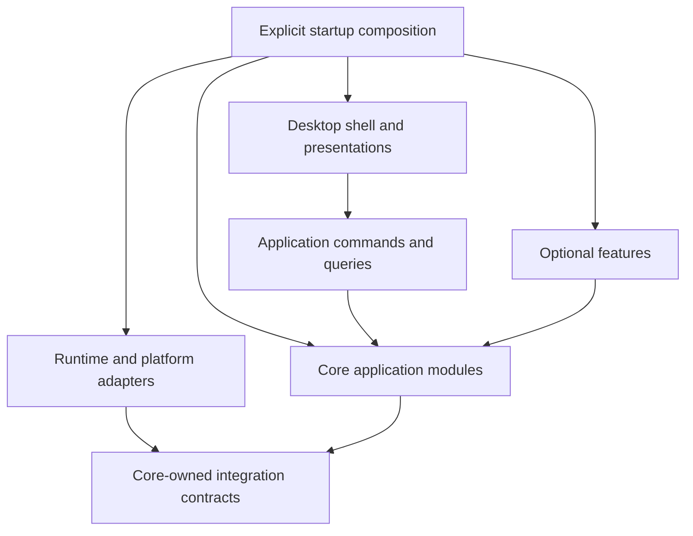

# Architecture

Status: evolving architecture with the headless MVP foundation and first desktop UI implemented, updated 2026-10-12.

This document is the architecture entry point required by [AGENTS.md](../AGENTS.md). It captures the agreed product direction and the boundaries used by the implemented headless MVP and desktop UI. Background hosting, browser integration, timeline, retrospective, orchestration, and isolated parallel work remain follow-on work.

## Product and implementation scope

The product is a desktop coding agent harness and control panel built around existing agent runtimes. The application owns its user experience, accounts, global sessions, and additional capabilities. The initial integrations are the Codex app server and Claude Agent SDK. Both are first-class runtime adapters behind a shared application contract; adding Pi or another harness should require a new adapter rather than provider-specific changes to core sessions, execution, permissions, or persistence.

Persistent computers, hosted by the product or connected by users, are a future extension. The initial application must work locally without that extension. Future hosting should reuse application behavior through a different host and adapters rather than require extracting rules from UI code.

Implementation proceeds one explicitly approved feature at a time. This document defines responsibility and dependency boundaries; detailed feature policies are refined with the user before implementation.

## Technology decisions and open choices

| Area | Direction | Status |
| --- | --- | --- |
| Product language | TypeScript for application code, adapters, UI behavior, and project tooling where practical | Selected by user |
| Desktop platform | Electron | Selected by user |
| UI library and styling | Framework-free TypeScript renderer with plain CSS, Phosphor icons, bundled Inter and IBM Plex Mono; see [desktop application](desktop.md) | Selected by user 2026-10-12 |
| Git hooks | Husky | Selected by user; hook policies still to define |
| Package management and development scripts | npm with Node.js tooling | Selected baseline |
| Running desktop application | Electron main for lifecycle and IPC validation; application services in a separate Electron utility process (execution host) | Selected by user 2026-10-12; supervision and background mode remain open |
| Build and packaging | esbuild bundles; @electron/packager for local app builds (asar off, ad-hoc signed); see [desktop application](desktop.md) | Selected for local builds 2026-10-12 |
| Distribution signing, updates, test tooling, storage, supported operating systems | Select when the corresponding foundation work is discussed | Open |

TypeScript describes the source language, not the runtime. Electron provides the desktop shell; the interface still needs web markup, styling, and UI components. Configuration, documentation, and minimal Git hook shell entry points use their appropriate formats.

### Application runtime and development tooling

Electron's main process runs in a Node.js environment, its renderers display web content, and its utility processes also run Node.js. A preload bridge connects the interface to privileged application operations. These are Electron's process boundaries; choosing a package manager does not replace them. See [Electron's process model](https://www.electronjs.org/docs/latest/tutorial/process-model).

Use npm for dependency management and project scripts, with Node.js development tooling. Compile application TypeScript for the selected Electron version. Keep application rules independent of Electron APIs and put platform-specific operations behind interfaces.

Pin tooling and dependency versions when the scaffold is approved, commit the npm lockfile, and use reproducible installs in CI. Development Node.js and Electron's embedded Node.js may differ; validate production code against the shipped Electron environment.

Before adopting the build setup, verify dependency installation, required package install scripts, native dependencies, and a packaged Electron launch. Passing headless unit tests alone does not establish Electron compatibility. No compatibility experiment has been run yet.

### Husky's role

Husky manages local Git hooks. Git remains the version control system. Proposed hooks should invoke project checks for branch naming, formatting, types, and relevant tests; exact checks and placement remain open. Keep substantial custom checking logic in TypeScript with minimal shell wrappers. See [Husky getting started](https://typicode.github.io/husky/get-started.html).

Local hooks can be disabled, so mandatory checks should also run in CI when CI is introduced. Automated checks support review of architecture, documentation, comments, attribution, and emoji rules; they do not replace that review. Git and Husky have not been initialized in this directory.

## Architectural approach

Use an explicitly assembled, modular application. Logical module boundaries do not require a separate process or package for every feature. Start with the smallest structure that enforces ownership, and introduce additional deployment boundaries only when justified.

1. Group application code by capability rather than global folders of controllers, services, and repositories.
2. Give each module a small public interface. Call operations such as account selection rather than mutating another module's state.
3. Keep rules independent of UI, Electron, provider SDKs, and storage implementations.
4. Supply external dependencies through narrow interfaces owned by the consuming capability.
5. Assemble concrete implementations in explicit startup code. Avoid import-time registration, global service locators, and hidden dependency discovery.
6. Keep the dependency graph acyclic. Cross-module workflows belong in the application coordinator responsible for that workflow.

## Core, optional features, and adapters

Core capabilities are mandatory parts of the product. They remain modular and separately understandable even though they cannot be disabled. Optional features build on the core without becoming dependencies of it. Adapters provide concrete implementations of external integration boundaries; an adapter is not itself synonymous with an optional feature.

Proposed ownership:

| Module | Owns | Boundary |
| --- | --- | --- |
| Authentication | Credential references, authentication lifecycle, access to credential storage | Other modules request authenticated access without reading secrets directly |
| Connections | The "Connect <provider> account" sign-in workflow | Coordinates provider sign-in connectors (adapters) with Accounts and the runtime-context resolver through their public interfaces |
| Accounts | Account identities, availability, selection, and switching policy | Provider-specific authentication and quota observations arrive through explicit interfaces |
| Sessions | Application session identity, conversation history, continuation context, and native session associations | Runtime session IDs are associations, never the global session identity |
| Execution | Run lifecycle, cancellation, recovery coordination, and execution records | Coordinates accounts, sessions, and runtimes through their public interfaces |
| Projects and workspaces | Project identity, workspace references, and environment association | Platform access is supplied through adapters |
| Timeline | Project history views and feature-specific indexes relating execution and code changes | Consumes core records and Git information without owning session execution |
| Retrospective | Post-run analysis and environment observations with provenance and validity | Contributes guidance through an explicit optional input; execution works without it |
| Orchestration | User-defined workflows and stage assignments across models/providers | Calls the same execution services used by a single interactive run |

The first six rows describe the implemented foundational modules. Connections sits above Accounts and Authentication so the dependency graph stays acyclic: Accounts depends on Authentication's credential types, and Connections depends on both.

Connected accounts use the `native_login` credential method: the provider keeps the credential in its own login store scoped to the account's private runtime-context directory (`auth.json` under `CODEX_HOME`, or the macOS Keychain entry keyed to `CLAUDE_CONFIG_DIR`). The app records only the opaque reference, and `NativeLoginCredentialResolver` resolves it to an empty environment because the runtime adapters already point the provider at that directory. Credential material therefore never passes through application code or records. Timeline, retrospective, and orchestration are optional modules maintained and shipped by the product owner, with on/off controls in settings. Third-party installation is not the intended meaning of optional. Specific adapter boundaries may emerge as integrations are validated.

### Concrete runtime contract

"Provider-neutral" has a strict meaning: core modules may import only application-owned contracts and data types. They must not import Codex app-server protocol names, Claude Agent SDK classes, provider transcript types, provider credential objects, or provider-specific event names. Those imports belong only inside `adapters/runtimes/codex` and `adapters/runtimes/claude`.

The implemented shared runtime contract uses these operations and values:

- `RuntimeAdapter.startRun(input)` starts an attempt from application-owned input containing the application session, attempt, workspace, prompt, selected model, permission mode, and optional native continuation reference.
- `RuntimeAdapter.resumeRun(input)` continues a provider-native attempt when the adapter reports that resume is supported.
- `RuntimeAdapter.cancelRun(attemptId)` requests interruption and reports whether the provider acknowledged it.
- `RuntimeAdapter.describePermissionMode(mode)` returns adapter-owned text describing the native controls used for an application permission mode, so clients disclose the mapping without provider-name conditionals.
- `RuntimeAdapter.capabilities(accountId)` returns explicit support flags for resume, fork, approvals, quota reporting, browser tools, computer use, and other optional behavior.
- The adapter emits normalized application events such as `message_delta`, `tool_request`, `tool_result`, `approval_request`, `usage`, `completed`, `failed`, and `interrupted`.

The Codex adapter translates these operations into app-server initialization, thread, turn, notification, approval, and interruption messages. The Claude adapter translates them into Agent SDK query, session, permission, and streaming operations. Core execution handles the normalized operations and events without checking which provider produced them. A provider-specific feature is exposed as a capability or an explicitly named adapter extension; it is not implemented as a provider-name conditional in core code or the renderer. The concrete implementation and deferred behavior are recorded in [MVP implementation](mvp.md).

The product requires users to bring their own provider subscriptions and requires multiple accounts in the first release. Each saved account therefore has its own provider identity, authentication mode, protected credential reference, runtime configuration context, and availability state. Switching accounts changes which account a new attempt uses; it does not mutate credentials for an active attempt. Concurrent attempts using different accounts must not share credential files, token caches, native session directories, or mutable runtime configuration.

Subscription authentication has documented technical support for both initial runtimes. The Codex app-server documentation describes ChatGPT-managed login and device-code login. Claude documents subscription OAuth tokens for SDK environments, separate account contexts through `CLAUDE_CONFIG_DIR`, account inspection, and subscription rate-limit events. The Agent SDK is intended to embed Claude Code's agent loop in an application, and the product decision is to proceed with that wrapper model using users' own subscriptions. This does not change the requirement to keep credentials and native session state isolated per account. See [runtime integration notes](runtime-integration-notes.md) for the concrete authentication path and isolation behavior.

## Dependency direction and composition



Arrows describe dependencies or assembly, not event flow. The composition root knows concrete implementations and passes them to consumers. Core code knows contracts, not concrete adapters. The desktop boundary exposes optional feature operations only when those features are assembled.

Use direct typed calls for commands and queries. Use structured events to notify observers about facts that already happened. Do not turn all application control flow into an event bus. Optional observers must not be required for a core operation to complete.

## Proposed source layout

This is an illustrative ownership map, not directories to create in advance:

```text
src/
  composition/             Explicit service and feature assembly
  desktop/
    host/                  Execution host utility process: composed app, active runs, command dispatch
    main/                  Electron lifecycle, windows, IPC handlers
    preload/               Narrow typed renderer bridge
    renderer/              UI shell and feature-specific presentation
  core/
    authentication/
    accounts/              Account identity, availability, selection, and switching policy
    sessions/
    execution/
    projects/
  features/
    timeline/
    retrospective/
    orchestration/
  adapters/
    runtimes/              Codex, Claude, and future runtime integrations
    storage/               Implementations of module-owned storage interfaces
    platform/              Credentials, filesystem, processes, environments
  contracts/
    desktop/               Serializable desktop commands, responses, events
docs/
  architecture.md
  changes.md
```

Within each capability, keep its rules, use cases, interfaces, and tests together. Add internal subdirectories only when useful. Public exports are intentional; other modules must not deep-import implementation files. Presentation stays grouped by feature inside the renderer, while application behavior remains in the owning core or feature module.

Contract ownership stays with the relevant module except for transport-specific schemas. A generic shared-types directory must not become a second domain model. Workspace packages can enforce larger boundaries later if needed; their introduction is not necessary for every module.

## Desktop and application separation

The implemented desktop process layout, contracts, and renderer structure are described in [desktop application](desktop.md). The execution host runs in an Electron utility process and owns the composed application and all in-flight runs; Electron main validates renderer requests and relays them; the renderer receives serializable views and events through a two-function preload bridge.

The graphical conversation view and terminal presentation must invoke the same application operations. Account switching, session persistence, and recovery are not UI responsibilities. The user's current direction is a terminal presentation of this harness inside the desktop window, not embedding an independent provider CLI. Rendering and terminal libraries remain undecided.

Keep Electron main responsible for lifecycle and desktop integration. Use a narrow preload API with context isolation and validate incoming IPC requests at the privileged boundary. The renderer receives serializable data and explicit operations, not raw IPC access, SDK objects, credentials, or arbitrary privileged execution capabilities.

Application modules must run headlessly for testing. Heavy or blocking work must not freeze the interface or main event loop. External agent processes remain behind runtime adapters, with explicit startup, cancellation, exit, and cleanup behavior.

### Execution lifetime and optional background work

The user wants local agents to stop when the harness exits by default, with a confirmation when work is active. They also want an activatable background mode that allows work to continue without open windows and accommodates future relay and remote access.

Proposed structure: the desktop UI connects to an execution host that owns runs, runtime processes, persistence, and pending approvals. Keep that host independent of renderer windows. A separate supervised Node.js host process is the current recommendation; process packaging and supervision are not yet selected.

- Default mode: an intentional harness exit stops owned runs and runtime processes. Persist completed outcomes and mark interrupted work accurately. Confirm before stopping active work; the exact dialog remains open.
- Background mode: closing the UI can leave the execution host running. Reopening the UI reconnects to existing runs instead of starting duplicate agents.
- Provide an explicit stop-all-and-exit operation in either mode. Distinguish closing a window, disconnecting a client, and stopping the execution host. The exact full-quit behavior and labels still need agreement.
- When a run needs user input and no UI is connected, preserve the pending request and wait for an authorized response. Background mode does not grant extra permissions.
- Future remote clients connect to the host that owns the work. A relay transports communication; it does not execute tasks or keep a sleeping local machine working. Host transfer, startup at login, crash restart, and remote authentication remain future design work.

The optional background feature changes host lifetime policy; it must not create a second implementation of sessions or execution. A windowless Electron process may suffice for some local background behavior, but it does not by itself establish an independently operated remote execution service.

## Runtime integration boundaries

Distinguish an agent runtime, a model provider, an account, and a selected model. They are related but not interchangeable identities: one runtime may support several providers and one provider may have several accounts.

Runtime adapters translate native requests, responses, events, errors, and session associations into application contracts. They expose supported capabilities, such as native resume, interruption, or quota reporting, rather than pretending every runtime supports every operation.

Shared operations use common interfaces. Runtime-specific extensions remain explicitly named and discoverable. Do not spread provider-name conditionals through core modules or renderer components.

The application wraps the existing runtimes and should reuse their available execution, browser, and computer-use capabilities. Availability must be verified per integration: a vendor's desktop product may expose features that its SDK does not. Pi's browser and computer-use capabilities remain unverified.

The initial documentation findings are recorded in [runtime integration notes](runtime-integration-notes.md). Account isolation and supported authentication are represented in the implemented adapters; browser reuse, complete cross-runtime context handoff, and distribution-specific authentication still need targeted verification before those features are exposed. The product requirements do not establish that upstream APIs already provide those deferred behaviors.

### Browser ownership under discussion

The user wants an app browser for manual browsing and agent access, and would prefer to reuse or manually open a provider browser if a supported integration permits it. Search/fetch tools, controllable browser tabs, and full desktop computer use are separate capabilities.

Proposed boundary: an app-level browser service owns tab and profile references and exposes a controlled tool interface to runtime adapters. Both the user and agent can access the same explicitly selected browser context. A provider browser can be another implementation if its API supports opening, observing, and controlling that context. The fallback proposal is an app-owned browser exposed through supported tools such as MCP; no provider-browser embedding capability has been verified yet.

Browser lifetime must account for background mode: closing the control panel must not implicitly destroy a browser still required by an active run. Browser context ownership, human takeover, login/profile scope, rendering technology, and remote placement remain discussion items. Website content must be isolated from the privileged desktop application bridge.

### App-owned permission modes

The app owns the selected mode and approve/decline interaction, and adapters translate that policy into supported runtime controls. Requested modes are read only, ask me, approve for me, and full access. Their exact action scopes and the reviewer used by approve for me remain open.

Read-only enforcement must cover tools that can mutate through commands, browser actions, or external services, not just file-edit tools. Approval callbacks are not necessarily invoked for every tool, so mappings must account for runtime allow rules, hooks, sandboxing, and any stricter upstream restrictions. Full access expresses the user's requested scope within available runtime and host permissions; it cannot override controls outside the app.

Do not silently weaken a mode when switching runtimes. If an adapter cannot enforce the requested policy, report that incompatibility rather than present an unsupported guarantee. Keep approval decisions scoped to the relevant action and attempt so a stale approval cannot authorize unrelated resumed work.

## Sessions, continuity, and records

Global sessions belong to the application and are grouped within projects. One user-facing conversation can be continued by Codex, Claude, or another supported runtime. This does not merge every independent conversation in a project into one transcript. Preserve structured conversation content, workspace references, execution outcomes, and continuation context independently from native runtime session IDs. Associate each execution attempt with its runtime, account, model, and any native continuation data.

Proposed identities: a session is the ongoing application conversation; a run is a requested unit of work; an attempt is execution using a particular account and runtime. Native Codex threads and Claude SDK sessions remain associated execution state under the application session. Naming and schema are proposals, not finalized contracts.

Cross-runtime continuation is a context handoff, not an assumption that opaque native sessions are interchangeable. Prefer native continuation when supported; otherwise prepare context at the handoff boundary. Do not invent missing tool results or transfer hidden model state.

Track how much of the application conversation each native continuation has seen. For a Codex-to-Claude-to-Codex sequence, the old Codex thread must receive relevant intervening work before continuing. Merely reopening its previous native ID would leave it unaware of Claude's work. Use supported input mechanisms or a fresh native context; do not rewrite opaque runtime transcripts into an invented universal format.

Recovery must distinguish completed actions, failed actions, and actions whose outcome is unknown. A continuation prompt alone cannot guarantee safe replay of an interrupted side effect. Maintain progress during execution so recovery does not require an exhausted account to generate a summary.

Account exhaustion should trigger automatic selection of an eligible same-provider account. If none exists, the user chooses a cross-provider model before continuation. These are product requirements; selection ordering, retry budgets, checkpoints, and ambiguous-action handling remain feature design work. Quota exhaustion and context-window exhaustion are separate conditions.

Use runtime-reported availability and reset information when supplied. Keep any additional tracking behind the account integration boundary. Do not encode unverified assumptions about subscription tiers or limit windows.

Core execution records support continuity independently of timeline. Optional features can build indexes or analyses from those records. Define stable identifiers, ordering within a run, and schema versions when records are implemented. Record only observable runtime information; do not promise traces that an upstream runtime does not expose.

## Workspace ownership and concurrent work

A session owns conversation context; a workspace identifies the files and environment a run operates on. Switching accounts or handing sequential work from one runtime to another continues in the same workspace. The app coordinates its own runs so only one editing run writes to a shared workspace at a time.

Independent parallel work uses isolated workspaces by default. Git worktrees are the preferred candidate for Git projects, with separate working directories and branches. Combining results is an explicit operation. The app must record which workspace and starting revision each run used so history can attribute changes correctly. For projects without Git, an isolation mechanism remains to be chosen when parallel work is implemented.

Creating an isolated workspace must account for uncommitted user changes; starting from the last commit alone can omit the actual project state. The method for transferring or snapshotting those changes remains open. Tests and review tools may mutate files or external services, so they are not automatically safe to run alongside an editing agent in the same workspace. Coordination of external editors and changes made outside the app remains a design task; the app should detect relevant drift before applying or merging agent results.

## Persistence and optional feature lifecycle

The execution host is the logical authority for application sessions and run progress. The UI and optional features request changes through public operations; they do not write execution tables or files directly. Each capability owns its persisted data schema and mutations. Storage adapters supply the implementation; the database and migration tooling remain open.

Store both current state for efficient queries and an append-only execution journal for the observed sequence of work. Where a recorded action outcome changes run state, commit those updates together in one storage transaction. A user-facing timeline may index or present the journal, but disabling timeline must not remove the core record needed for continuity and recovery.

Record the requested action, its runtime and account attempt, confirmed outcomes, and uncertain outcomes. A database transaction cannot atomically include an arbitrary shell command, browser submission, or provider operation. If the host crashes after an external action succeeds but before recording success, mark its outcome unknown and investigate before retrying. A checkpoint identifies the last recorded progress and continuation context; it does not restore the entire computer.

Keep native runtime transcripts and identifiers separately for provider-supported resume. Store large outputs, screenshots, and diffs as referenced artifacts instead of loading them with ordinary session history. Keep credentials in protected storage outside conversation and execution records. Retention, backup, encryption, and artifact storage formats remain open.

Version persisted sessions and records, and supply explicit migrations as their schemas evolve. Keep credentials out of conversation and execution logs. Provider-native payloads should remain scoped and versioned rather than silently becoming universal application data.

Optional features are bundled, first-party modules with settings toggles. They declare their required core capabilities and any optional relationships. Composition validates those dependencies and registers their UI contributions and subscriptions. Disabling a feature removes its contributions and stops its workers without deleting its stored data or breaking basic execution. The behavior of a toggle during active work must be defined per feature. Downloadable plugins, arbitrary third-party code, and runtime code unloading are outside the current scope. Themes and fonts are settings, not a reason to create a plugin system.

Retrospective observations must be associated with the relevant environment and support invalidation or rechecking. A transient browser failure must not permanently declare that browser unavailable on every computer.

## Performance and future computers

Performance is a requirement to measure, not a guarantee implied by modularity. Keep normal execution incremental: stream updates, bound queues, paginate histories, and avoid repeatedly loading or translating entire sessions. Keep optional analysis outside the critical execution path. Durable recovery records need a defined write ordering; a disposable event subscription is insufficient for persistence.

Before setting budgets, measure startup, streaming responsiveness, persistence overhead, memory use, and handoff latency. Check performance in the packaged app as well as development mode.

Keep local workspace and execution access behind focused platform interfaces. Use explicit environment references where sessions and workspace operations need them, rather than embedding the assumption of one local computer everywhere. Future remote adapters can introduce transport, remote identity, and connectivity handling. Do not build a generic distributed platform or remote desktop protocol now.

## Verification and evolution

As implementation begins, enforce import boundaries and cycles with tooling. Test meaningful application rules independently of the UI; verify adapter behavior against the contracts it claims to support. Exercise optional feature removal, account isolation, recovery, and cross-runtime handoff when those features are implemented. Electron integration and packaged smoke checks remain necessary alongside headless unit tests.

Before each approved feature, identify its owner, public contracts, dependencies, data changes, and validation. Update this document when those boundaries change and record the change in [changes.md](changes.md). Add focused decision records for consequential choices once they are actually made, rather than pre-generating decisions for speculative features.

## Architectural gaps to resolve before foundational implementation

The following questions affect multiple modules. They are discussion items, not approved implementation decisions. Resolve them progressively, beginning with runtime feasibility and execution ownership.

| Priority | Gap | Decision or evidence needed | Why it matters |
| --- | --- | --- | --- |
| 1 | Runtime feasibility and account isolation | Verify Codex and Claude subscription authentication for a third-party wrapper, required approval status, independent credential/configuration contexts for multiple accounts, quota signals, event access, and resume behavior. Distinguish API credentials from subscription-backed accounts. | BYO subscriptions and multiple accounts are first-release requirements; a generic adapter cannot manufacture unsupported login or isolation behavior. |
| 2 | Execution ownership and lifetime | Default stop-on-exit and optional background execution are requested. Decide host supervision, exact quit behavior, and reconnection protocol. | Determines process supervision, IPC, shutdown, and future remote hosting boundaries. A separate process is not by itself an independent background service. |
| 3 | Session and recovery contract | Agree on session, run, attempt, and checkpoint identities; define canonical recorded content, native continuation data, and ownership of writes. | Affects account handoff, restart recovery, timeline, and orchestration. One logical session must not imply unrestricted concurrent mutation of one conversation. |
| 4 | Execution authority and permissions | Four app-owned modes are requested. Define their exact scopes, the approve-for-me reviewer, runtime mappings, and preservation of pending approvals. | UI modes, runtimes, and account switching must not create inconsistent authority. Do not assume every runtime can route all tools through an app-owned executor. |
| 5 | Workspace concurrency | Shared workspace for sequential handoffs; one app-managed writer per shared workspace; isolated workspaces for independent parallel work. Decide how to include uncommitted changes, detect external edits, and isolate projects without Git. | Future orchestration, code attribution, and timeline accuracy depend on this boundary. |
| 6 | Durable storage ownership | Execution host owns application state and an append-only journal; outcome and state updates should be atomic where possible. Select a storage engine, artifact format, migrations, retention, backup, and recovery handling for unknown external outcomes. | The chosen store must make confirmed progress trustworthy without claiming arbitrary tool actions can be rolled back atomically. |
| 7 | Optional feature lifecycle | Scope clarified: bundled first-party modules toggled in settings. Define per-feature behavior when disabling during active work. | Stopping an optional worker must not abandon core runs or delete their history. |
| 8 | Presentation, browsers, and distribution | Terminal mode is intended as this harness's presentation. Browser sharing and ownership need agreement. Identify initial operating systems and how runtime executables are supplied and updated. | Determines whether interfaces retain core guarantees and whether integrations work in the packaged application. |

Detailed retrospective policies, orchestration editing, timeline presentation, and model-selection UX can wait for their feature discussions. Exact UI, storage, build, and testing libraries should be selected when the corresponding foundation work is approved; those library choices should not substitute for the ownership decisions above.
