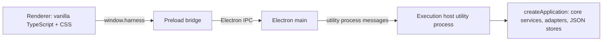

# Desktop application

Status: first desktop UI implemented, 2026-10-12. It presents the headless MVP described in [MVP implementation](mvp.md) according to the [UI specification](ui-spec.md). Background mode, packaging, authentication flows, and automatic host recovery are not implemented.

## Process layout



| Process | Source | Owns |
| --- | --- | --- |
| Execution host | `src/desktop/host/` | The composed application, every in-flight `ExecutionHandle`, pending approvals, and the command dispatcher. Started with `utilityProcess.fork`. |
| Electron main | `src/desktop/main/` | App lifecycle, the window, request validation at the privileged boundary, relaying commands to the host, broadcasting host events, native dialogs (the folder picker), and stop-on-exit. Holds no application state. |
| Preload | `src/desktop/preload/` | Exposes `window.harness` with `invoke`, `onEvent`, and `selectDirectory` only. Raw `ipcRenderer` is never exposed. |
| Renderer | `src/desktop/renderer/` | Presentation. A view cache of host data that can be rebuilt from host queries at any time. |

The host runs outside main so provider processes and JSON persistence never block the window event loop, and so the future background mode can decouple the host's lifetime from windows without moving application code. This follows the architecture's recommendation of an execution host independent of renderer windows. The host is not yet supervised: if it exits, main reports `host.status: exited`, pending requests fail with `host_unavailable`, and the renderer shows a banner. Restarting a crashed host and recovering runs it left in `running` need a recovery policy first.

## Contracts

`src/contracts/desktop/` holds the serializable transport schemas shared by all four processes:

- `commands.ts`: `HostCommandMap` (command name to params and result) plus a runtime validator per command. Main validates every renderer request and the host validates again. Unknown keys are rejected.
- `events.ts`: `HostEvent`, facts the host broadcasts (`run.started`, `run.updated`, indexed `run.event`, `run.approval_resolved`, `run.cancel_requested`, `run.finished`, and `*.changed` refresh signals). Main adds `host.status`.
- `views.ts`: read models. They reuse core types through type-only imports, except `AccountView`, which omits the credential reference and runtime-context ID.
- `errors.ts`: stable `HostErrorCode`s with structured `details` (for example, the owning attempt for `workspace_busy`). Clients branch on codes and never parse messages.

To add a command, add an entry to `HostCommandMap` and `COMMAND_VALIDATORS`, then add a handler in `HostApi`. The handler table is typed against the map, so a missing handler is a compile error.

## Host behavior

`HostApi` (`host-api.ts`) has no Electron dependency and is covered by headless tests. `ActiveRuns` (`active-runs.ts`) is the only consumer of each handle's `events`:

- Each event is broadcast with its index within the run, and the host keeps a copy of every event for active runs. `runs.active` returns those snapshots with pending approvals. A client that reconnects subscribes first, renders the snapshot, and then applies only live events whose index is not yet in it. Reloading the renderer never restarts or duplicates a run.
- Approvals stay pending in the host until any client answers them. A renderer disconnect is not a cancellation.
- `runs.cancel` is idempotent. The run stays active until the runtime reports a terminal state.
- Before starting, `runs.start` refuses a workspace that already has a writer and returns `workspace_busy` with the owning attempt. The core lock remains the authoritative guard. When no account is named and the provider's selected account was not used, the result reports `fallbackFromAccountId`.

## Exit behavior

This implements the default stop-on-exit policy from the architecture. Closing the last window quits the app on every platform. If runs are active, main asks for confirmation, sends the host a `shutdown` message that cancels every run and waits up to 10 seconds for terminal states to be persisted, and then terminates the host. If the user chooses to keep working, the window reopens. The confirmation wording is provisional.

## Renderer

The renderer is framework-free TypeScript with plain CSS. `store.ts` holds one immutable state object. Panels subscribe through selectors and re-render only the slice they watch, with updates batched to animation frames. Forms live in static DOM so typing is never interrupted. `controller.ts` is the only module that calls the host and maps error codes to messages. `transcript.ts` is a pure function that folds runtime events into display items for both live runs and reconnect snapshots. Features under `features/` are mounted explicitly from `app.ts`.

Layout:

- **Toolbar.** A slim bar above the session holds the left and right sidebar toggles and the session title with its workspace path. On macOS it is also the window drag region and leaves room for the window controls.
- **Accounts (Settings).** "Connect Codex account" and "Connect Claude account" buttons come from `auth.providers`. A sign-in shows a progress card: the browser step (with "Open sign-in page"), a device code, or a code field when the provider asks for a pasted code, plus Cancel. Saved accounts have Select and Reconnect. When no account exists, the composer shows a "Connect an account" pill. The renderer opens the sign-in page itself only when the provider did not (`urlOpenedByProvider`), and only for sign-ins started in that window. Main opens https links in the default browser.
- **New project.** The folder-plus button opens the native folder picker. Choosing a folder opens a small "New project" dialog, pre-filled with the folder name and path, that has a Browse button to change the folder and the optional root-workspace checkbox. The folder picker is a desktop-shell operation: main shows it through `selectDirectory` and returns only the chosen path, and no host command is involved. The workspace form's path field has the same Browse button.
- **Left sidebar.** It is retractable. A project tree fills the upper part: each project is a folder, and its sessions nest beneath it on condensed single-line rows (icon, title, relative age) along a guide line. A folder's plus button opens an inline new-session form with a workspace picker. A session with an active run shows a spinning icon, and a collapsed folder shows the spinner in place of its session count. The lower part lists the current project's workspaces, and Settings is at the bottom. When the sidebar is collapsed, moving the pointer to the window's left edge slides it in over the content. It hides again when the pointer leaves, unless focus or one of its menus is still inside.
- **Main column (chat).** Each run is one turn. The prompt is a right-aligned bubble, and long prompts are clipped behind "Show full message". The reply is plain page text rendered from a small, safe Markdown subset (`markdown.ts`: paragraphs, headings, lists, quotes, fenced code, inline code, bold, italic, and http(s) links that open in the default browser; DOM is built from text nodes only). Active runs stream text and show compact one-line tool rows that expand to input and output, plus approval cards; answered approvals collapse to one line. A quiet meta row under each reply has copy, time, runtime/account/model/permission labels, "Details" (inline run details: usage, labelled rows, permission mapping, status guidance, recovery, journal), and "Stop" while active. A left-edge navigator shows one tick per turn and highlights those in view, and a "Scroll to end" pill appears away from the bottom.
- **Composer.** One card holds an auto-growing prompt and a toolbar of pill menus (permission, runtime, account, model) plus a round send button. The send button becomes a stop button while the session has an active run. Enter sends and Shift+Enter inserts a newline. Capability flags and native permission mappings appear in the menu option descriptions. Modes that need approvals are disabled when the runtime reports `approvals: false`. The account menu groups accounts by provider, each with an "Auto" entry that lets the host choose.
- **Right sidebar.** It is retractable with a toggle and has no hover reveal. It shows an "Open a surface" launcher listing the core Changes surface plus every plugin surface enabled in Settings, Plugins, each with a single-key shortcut that works while the launcher is visible. Opening a surface shows it with a back button. No surface has content yet: Changes shows an empty state, and plugin surfaces state that they are previews (`surfaces.ts` defines them).
- **Settings overlay.** General (appearance), Accounts (registration, selection, re-authentication), and Plugins (preview toggles stored per device) work. Permissions, Shortcuts, Notifications, About, Startup, and Exit behavior are labelled placeholders. When plugins gain host-side behavior, their toggles must move to the host so composition can validate dependencies.

Sidebar collapse state, expanded folders, enabled plugins, and appearance are per-device renderer preferences stored in `localStorage`.

Custom dropdowns (`components/dropdown.ts`) replace every native `<select>`. They render in a popover attached to `<body>` (`components/popover.ts`) that opens upward when there is no room below. They follow the listbox keyboard pattern (arrows, Home/End, type-ahead, Enter, and Escape) and support option icons, descriptions, groups, and disabled options.

Visual language: neutral charcoal or off-white surfaces, rounded cards, an inverted primary button, Inter for prose, and IBM Plex Mono for labels and values. There are no status dots. Status is always an icon plus a word. Icons are Phosphor (`@phosphor-icons/core`, regular weight), imported individually in `icons.ts` and inlined by esbuild. Fonts are bundled from `@fontsource`, so the strict Content-Security-Policy never allows a remote host.

Appearance is Light, Dark, or System, chosen in Settings, General. The choice is a per-device preference stored in `localStorage`. System follows `prefers-color-scheme`. All colors are CSS variables on `:root`.

## Build and run

```bash
npm run start          # bundle to dist-desktop/ and launch Electron
npm run build:desktop  # bundle only (scripts/build-desktop.ts, esbuild)
npm run typecheck      # Node and renderer tsconfig projects
npm run check          # typecheck, headless build, tests, desktop bundle
npm run package        # bundle, then package an app for this OS/arch into release/
```

Packaging (`scripts/package-desktop.ts`, @electron/packager) builds a local app bundle such as `release/Thinking and Code-darwin-arm64/Thinking and Code.app`. Install it by copying it to `/Applications`. Decisions:

- asar is off, because the Claude Agent SDK executes a native `claude` binary from its platform package and executables cannot run from inside an asar archive.
- Only runtime files ship. Packager prunes devDependencies. Icons and fonts are bundled by esbuild, so they are devDependencies.
- macOS builds are ad-hoc signed (`codesign -s -`) for a consistent local signature. They are not signed for distribution or notarized, so they are intended for the machine that built them.
- A packaged app launched from Finder has a minimal `PATH`. Main resolves the login shell's `PATH` once at startup (`shell-path.ts`) and passes it to the execution host, so the `codex` and `claude` CLIs are found.

`THINKING_AND_CODE_DATA_DIR=/path` makes the host use a separate data directory instead of `~/.thinking-and-code`. The Electron binary is downloaded by its package install script. If npm's install-script policy skipped it, run `node node_modules/electron/install.js`.

## Known gaps

- The Claude sign-in drives the interactive `claude auth login --claudeai` command. Its output is not a stable protocol, so URL and code-prompt detection is best-effort. It has not been exercised end to end from the app.
- A reconnect leaves the account's previous runtime-context directory, and the login inside it, on disk, because an active run may still use it. Cleaning up superseded contexts needs a policy.
- Accounts registered by reference (headless `accounts.register`) are `unknown` until an adapter reports availability. Connected accounts are marked `available` on a successful sign-in.
- Tool results carry no call ID, so the transcript pairs each result with the most recent unanswered tool request.
- Packaging produces unsigned (ad-hoc) local builds only: there is no distribution signing, notarization, auto-update, app icon, or installer. Node packages stay external to the main and host bundles.
