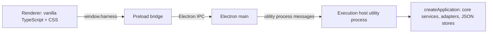

# Desktop application

Status: first desktop UI implemented, updated 2026-10-14. It presents the headless MVP described in [MVP implementation](mvp.md) according to the [UI specification](ui-spec.md). Background mode, distribution packaging, and automatic host recovery are not implemented.

## Process layout

Settings > Accounts includes **Connection details** actions opening a right-side
drawer with an explicit **Test connection** button (2026-10-16). These report local executable,
version, startup and sign-in observations with pending/error states and a
timestamp. They do not start login or model work, and results are cleared on
window reload or account reconnect. See [account connection checks](accounts.md#connection-checks-2026-10-16).



| Process | Source | Owns |
| --- | --- | --- |
| Execution host | `src/desktop/host/` | The composed application, every in-flight `ExecutionHandle`, pending approvals, and the command dispatcher. Started with `utilityProcess.fork`. |
| Electron main | `src/desktop/main/` | App lifecycle, the window, request validation at the privileged boundary, relaying commands to the host, broadcasting host events, native dialogs (the folder picker), and stop-on-exit. Holds no application state. |
| Preload | `src/desktop/preload/` | Exposes the typed `window.harness` bridge, including host commands and narrow desktop operations. Raw `ipcRenderer` is never exposed. |
| Renderer | `src/desktop/renderer/` | Presentation. A view cache of host data that can be rebuilt from host queries at any time. |

The host runs outside main so provider processes and JSON persistence never block the window event loop, and so the future background mode can decouple the host's lifetime from windows without moving application code. This follows the architecture's recommendation of an execution host independent of renderer windows. The host is not yet supervised: if it exits, main reports `host.status: exited`, pending requests fail with `host_unavailable`, and the renderer shows a banner. Restarting a crashed host and recovering runs it left in `running` need a recovery policy first.

## Window chrome and spacing (2026-10-16)

Windows/Linux use a theme-colored File/Edit/View/Help strip without a visible
application title. Native minimize/maximize/close controls remain OS-owned and
receive the resolved palette colors. macOS retains its native menu and title-bar
behavior. Menus support arrows, Escape, F10 and Alt+F/E/V/H; existing edit actions
return focus to the editor before invoking the native operation.

The sidebar retains the `thinking & code` wordmark below the menu strip to
identify the app; only the duplicate native window title is hidden.

The preload exposes only allowlisted `windowAction` operations and validated hex
colors through `windowTheme`. Main verifies the bundled-page sender and owns all
native effects. Closing and quitting retain the active-run exit policy.

Account cards, settings, dialogs and tool panels have more consistent padding,
button spacing and quieter borders. Connection details use a right-side drawer
with focus containment, focus restoration and reduced-motion support. Closing a
drawer hides it without cancelling an already requested bounded check.

Changes status and empty-state copy have a 16px horizontal inset. Panel splitters
use a 10px grab area and start from the visible width after window fitting, while
saved preferences remain available when the window grows. Fitting reserves room
for both visible panels and the main column; interrupted drags clear the resize
cursor. Arrow keys and double-click reset remain supported.

## Contracts

`src/contracts/desktop/` holds the serializable transport schemas shared by all four processes:

- `commands.ts`: `HostCommandMap` (command name to params and result) plus a runtime validator per command. Main validates every renderer request and the host validates again. Unknown keys are rejected.
- `events.ts`: `HostEvent`, facts the host broadcasts (`run.started`, `run.updated`, indexed `run.event`, `run.approval_resolved`, `run.cancel_requested`, `run.finished`, and `*.changed` refresh signals, including the optional `timeline.changed`). Main adds `host.status`.
- `views.ts`: read models. They reuse core types through type-only imports, except `AccountView`, which omits the credential reference and runtime-context ID.
- `errors.ts`: stable `HostErrorCode`s with structured `details` (for example, the owning attempt for `session_busy`). Clients branch on codes and never parse messages.

To add a command, add an entry to `HostCommandMap` and `COMMAND_VALIDATORS`, then add a handler in `HostApi`. The handler table is typed against the map, so a missing handler is a compile error.

The folder commands are `projects.list` and `projects.create`. Sessions, runs, and model discovery use `projectId`; refresh notifications use `projects.changed`. Old `workspaces.*` commands are no longer accepted. Legacy saved data migrates automatically as described in [MVP implementation](mvp.md).

## Host behavior

`HostApi` (`host-api.ts`) has no Electron dependency and is covered by headless tests. `ActiveRuns` (`active-runs.ts`) is the only consumer of each handle's `events`:

- Each event is broadcast with its index within the run, and the host keeps a copy of every event for active runs. `runs.active` returns those snapshots with pending approvals. A client that reconnects subscribes first, renders the snapshot, and then applies only live events whose index is not yet in it. Reloading the renderer never restarts or duplicates a run.
- Approvals stay pending in the host until any client answers them. A renderer disconnect is not a cancellation.
- `runs.cancel` is idempotent. The run stays active until the runtime reports a terminal state.
- Before starting, `runs.start` refuses a second run in the same session and returns `session_busy` with the owning attempt. Other sessions of the project may be running: shared sessions concurrently in the project folder, and isolated sessions in their own worktrees (see [concurrent sessions](concurrent-sessions.md)). The core writer registry remains the authoritative guard. When no account is named and the provider's selected account was not used, the result reports `fallbackFromAccountId`.

## Exit behavior

This implements the default stop-on-exit policy from the architecture. Closing the last window quits the app on every platform. If runs are active, main asks for confirmation, sends the host a `shutdown` message that cancels every run and waits up to 10 seconds for terminal states to be persisted, and then terminates the host. If the user chooses to keep working, the window reopens. The confirmation wording is provisional.

## Renderer

The composer has a clipboard button with an upward-opening attachment menu:
Images, Documents, Code and text, or Any file. Multi-file selections appear as
removable filename/size chips and can be sent with or without prompt text.
Sent attachments remain visible on their turn after reload. Copies live in
session-owned storage outside the project, with limits of 20 files per message
and 50 MB per file. See [session file attachments](attachments.md) for runtime
reading, per-session drafts, process boundaries, and retention.

The renderer is framework-free TypeScript with plain CSS. `store.ts` holds one immutable state object. Panels subscribe through selectors and re-render only the slice they watch, with updates batched to animation frames. Forms live in static DOM so typing is never interrupted. `controller.ts` is the only module that calls the host and maps error codes to messages. `transcript.ts` is a pure function that folds runtime events into display items for both live runs and reconnect snapshots. Features under `features/` are mounted explicitly from `app.ts`.

Layout:

- **Toolbar.** A slim bar above the session holds the left and right sidebar toggles and the session title with its project path. On macOS it is also the window drag region and leaves room for the window controls.
- **Accounts (Settings).** "Connect Codex account" and "Connect Claude account" buttons come from `auth.providers`. A sign-in shows a progress card: the browser step (with "Open sign-in page"), a device code, or a code field when the provider asks for a pasted code, plus Cancel. Saved accounts have Select and Reconnect. When no account exists, the composer shows a "Connect an account" pill. The renderer opens the sign-in page itself only when the provider did not (`urlOpenedByProvider`), and only for sign-ins started in that window. Main opens https links in the default browser.
- **Project creation.** The folder-plus button opens the native folder picker. Choosing a folder creates one project through `projects.create`, or reuses it when that folder was already added; its folder name is the display label. Duplicate saved paths consolidate during startup, bringing both sets of sessions under one row. There is no separate workspace record, setup form, or typed path field. The folder picker is a desktop-shell operation: main shows it through `selectDirectory` and returns only the chosen path.
- **Left sidebar.** It is retractable and resizable: drag its right edge (200-480 px), or focus the edge and use the arrow keys; double-click resets to 256 px. The navigator contains a unified project tree; standalone chat navigation remains deferred. Project folders in the left navigator have no vertical gap between their blocks. Expanded session lists also have no extra top/bottom margin, while folder rows retain their existing click targets and indentation. The project tree lists every project folder, with its sessions nested beneath it on padded rows along a guide line. A project's database button opens local Codex/Claude session discovery, preview, and import (see [local session import](session-import.md)). Its plus button immediately creates a session with a generated title; there is no session title or project picker form. A session with an active run shows a spinning icon, and a collapsed project shows the spinner in place of its session count. A session whose run is waiting for an approval or question answer shows a pulsing hand icon and "Needs input" in place of its age, whether or not it is the open session; a collapsed project shows the hand instead of its count. Waiting outranks running, and the state comes from the host's pending approvals and questions, so it survives renderer reloads. The folder name and optional starting revision are shown; shared/isolated folder kinds are no longer part of the project model. Settings is at the bottom. When the sidebar is collapsed, moving the pointer to the window's left edge slides it in over the content. It hides again when the pointer leaves, unless focus or one of its menus is still inside.
- **Main column (chat).** Each run is one turn. The prompt is a right-aligned bubble with no expandable `userMessage` metadata, and long prompts are clipped behind "Show full message". The reply is plain page text rendered from a small, safe Markdown subset (`markdown.ts`: paragraphs, headings, lists, quotes, fenced code, GitHub-style pipe tables with column alignment, inline code, bold, italic, and http(s) links that open in the default browser; DOM is built from text nodes only). Tables scroll horizontally inside their own frame when wider than the column, and a table that is still streaming renders as text until its delimiter row is complete. Active runs stream text and show tool activity cards with readable command/file targets, outcomes, durations, output, and styled diffs. Provider-exposed thinking text is shown directly as prose beside a lightbulb, with no text label; the lightbulb collapses it to a one-line preview. Summaries and traces remain distinguishable through the lightbulb's accessible name and tooltip. Pending approvals are not transcript items; they appear in the composer overlay. While a run is queued/running, its reply ends with an animated three-dot progress indicator. The date/time footer appears only after it ends. Stop remains in the composer; diagnostic information is available in the right panel’s Run details surface. A left-edge navigator shows one tick per turn and highlights those in view, and a "Scroll to end" pill appears away from the bottom.
- **Composer.** One card holds a resizable prompt, clipboard attachment action, permission/account icon menus, one model-settings pill, and a compact send button. The model pill opens a compact dropdown above the composer with model names grouped by provider. There is no search field, heading or backdrop; descriptions are available in tooltips. Choosing a model replaces the list with its reasoning slider and a small Fast on/off tag. The back arrow returns to the list; the checkmark closes the dropdown. Clicking outside or Escape also dismisses it, and both stages stay anchored to the picker. Reasoning stops follow the reported levels in order, using the last supported choice, the reported default, or a synthetic Default stop when none is reported. Models without reasoning controls show automatic reasoning. Fast is enabled only for models whose adapters report both standard and fast options; its boolean preference carries across supported models. Provider/runtime routing stays hidden in the selected model. Discovery refreshes after account/project changes and reports partial failures while retaining successfully discovered models. The send button becomes Stop while the session has an active run. Enter sends, Shift+Enter inserts a newline, and Escape stops the current session's run without clearing the draft. Open menus, modals and Settings consume Escape first. Pending permission requests float above the composer and show only the proposed action/target, diff or arguments, and provider reason. Allow/Deny answer that request without submitting or cancelling the turn. The permission menu contains Ask me, Approve for me, Full access, and Read only; unsupported modes stay disabled and native mappings remain in Run details. The account menu is filtered to the selected model's provider and includes Auto.
- **Right sidebar.** Retractable via its toolbar toggle, and resizable by dragging its left edge (260-760 px, default 320 px). The Changes tool provides compact Staged Changes, Changes and Merge Changes file lists, counts, colored status letters, and repository/branch headers. Selecting a file opens its numbered inline or split diff; partially staged files have separate staged and working-tree comparisons. Repository discovery actions live in an options menu. See [Changes panel](changes-view.md) for behavior and limits. Reads refresh while visible, starting at two seconds and backing off to ten seconds when unchanged, on project/run transitions, and on Refresh. Hidden windows stop polling and refresh on return. This includes pre-existing edits; it is not a per-run attribution. A blank **New tab** opens with an icon grid of implemented tools, without opening any tools automatically. Choose an item to fill the tab. **+** retains its dropdown for adding another blank tab or a tool tab, and **x** closes a tab. Closing the last tab collapses the right sidebar and focuses its toolbar toggle. Reopening shows a blank launcher tab. Tab choices last for the window; switching/closing tabs preserves the shell, page and file drafts. Arrow keys and Home/End navigate tabs; Delete closes the focused tab. Timeline is a functional plugin (per-session opt-in, recorded checkpoints, file trees, and diff previews; see [Timeline](timeline.md)). Terminal, Browser and Files are interactive surfaces; see [desktop tools](desktop-tools.md). Retrospective and Orchestration stay out of navigation until implemented. Run details includes a run picker, usage, account/model/permission mapping, recovery and journal.
- **Settings overlay.** General (appearance), Accounts (registration, selection, re-authentication), Models (star favorites), Plugins (implemented tool toggles stored per device), Shortcuts (existing keyboard controls), and About (built package version, host connectivity and account link) are available. Planned permissions, notifications, startup and exit-behavior preferences are omitted. Focus remains inside Settings and returns to its opener on close; nested drawers and popovers handle their own keys first. Appearance radios support arrow keys and one Tab stop per group.

Timeline opens its read-only **Project history** view by default, showing existing Git commits and saved Rack/Codex/Relay session snapshots without recording opt-in or a selected session. Clicking a project folder selects it even if it has no sessions; toggling the already-selected folder preserves its current session. **This session** retains exact-session import and future recording controls. Both views share file trees and diff previews; project history polls while open and supports manual Refresh. See [Timeline](timeline.md) for bounds and provenance.

Saved Git projects now record file changes automatically for the desktop host's lifetime, including old projects with no Timeline refs or sessions. Initial current edits compare against HEAD, then watchers record later edits. Project history has persisted Pause/Resume controls. Session-associated run capture remains independent. Enabling or hiding the Timeline surface only controls visibility.

Timeline entries and inline previews have an expand action that opens a separate native snapshot window. It has Changed files / All files, a collapsible folder tree and path filter, and **Diff**, **Before / After** (split), and **Full context** modes. All files includes unchanged and deleted paths from the historical comparison. Contents are read lazily from Git objects; switching chat sessions or editing working files does not change the selected snapshot. Escape closes only that viewer. See [Timeline](timeline.md#expanded-snapshot-window) for content limits and notices.

The expanded viewer uses a prominent bordered **Change** dropdown for other commits and observations in the same project, including other sessions. Up/down buttons open newer/older changes, with a position counter in newest-first order; buttons disable at the ends of history. A **View mode** dropdown offers **Diff**, **Before / After**, and **Full context**. Navigation preserves the view mode and selected file when available, and list refresh never jumps to a newer comparison or removes a currently selected known target. Escape dismisses an open dropdown before closing the viewer.

Before / After highlights added and replacement lines in the After pane while retaining full source and independent scrolling. Shortened diffs show an explicit highlighting notice. Timeline also supports a selected container folder with a single discoverable nested Git repository, such as `rack-desktop/rack-code`; history and recording use that repository. Unsupported container folders show a **Choose a repository** list of discovered paths and **Scan deeper**. Clicking a folder reuses or adds its project record and displays that repository in Timeline while preserving the selected chat, messages and unsent draft. A repository label and **Back to project** action identify the local view. Switching the chat to another project resets that view. An unsupported This session view links to the project folder chooser.

Local session import supports per-row checkboxes, Select all for not-yet-imported sessions, a selected count, and partial-failure retries. Successful imports remain saved if another source fails.

Thinking and tool activity remain visible after a run finishes. The recent-session renderer cache retains live events at completion and rebuilds saved activity from the execution journal after reload. Tool IDs correlate parallel calls; output deltas do not mark a tool complete.

Links and paths are clickable. Bare http(s) URLs in replies are linked (both schemes open in the default browser; other schemes are refused). File paths in replies, inline code, file activity targets, approval targets, and the Changes file list call `openPath`; relative paths resolve against the session's isolated worktree, shared project folder or private chat workspace (or the repository folder in Changes), and a `:line[:col]` suffix is ignored when opening. Electron main (`main/open-path.ts`) opens documents and folders with their default application but only reveals in Finder anything whose default open could execute code (execute bit, scripts, `.app` and other bundles, installers, `.py`). A missing path shows a notice.

Scrollbars are minimal: 4 px rounded thumbs with no track, shown only while the pointer is over the scrolling region.

Sidebar collapse state, panel widths, expanded folders, enabled plugins, model favorites, and appearance are per-device renderer preferences stored in `localStorage`.

**Settings > Models** lists the full available catalog grouped by provider, with a star button for each model. Only starred, currently available models appear in the composer's model dropdown. Favorites are stored as provider/runtime/model keys under `models.favorites`; labels and account IDs do not define their identity. No models are starred automatically. Empty favorites offer **Choose favorites** and disable sending. Unstarring the selected model selects another available favorite, or clears selection if none remain. Temporarily unavailable favorites stay saved and reappear when their catalog entries return. Reasoning and Fast controls retain their behavior for selected favorites. Star buttons expose pressed state and retain keyboard focus after toggling.

The renderer uses theme-styled choice controls. Custom dropdowns (`components/dropdown.ts`) replace every native `<select>`, including the Changes repository and Run details pickers, which are created once and re-attached so re-renders do not close an open menu. Menus render in a popover attached to `<body>` (`components/popover.ts`) that opens upward when there is no room below. Popovers are capped at 320 px (configurable per popover) and scroll beyond that, with provider group headings pinned while scrolling. Dropdowns follow the listbox keyboard pattern (arrows, Home/End, type-ahead, Enter, and Escape) and support option icons, descriptions, groups, and disabled options. `components/checkbox.ts` provides ARIA checkboxes with checked, mixed, and disabled states. Agent question cards use theme-styled radio/checkbox inputs with explicit dimensions and focus indicators.

Visual language: neutral charcoal or off-white surfaces by default, with optional emerald, burgundy, purple, or Flexoki surfaces and primary accents; rounded cards; Inter for prose; IBM Plex Mono for labels and values; and [Geist Mono](https://fontsource.org/fonts/geist-mono) for code, tool output, and diffs. There are no status dots. Status is always an icon plus a word. Icons are Phosphor (`@phosphor-icons/core`, regular weight with a filled star for favorites), imported individually in `icons.ts` and inlined by esbuild. Fonts are bundled from `@fontsource`, so the strict Content-Security-Policy never allows a remote host. Geist Mono is pinned and bundled with its OFL license.

Settings, General offers Neutral, Emerald, Burgundy, Purple, and Flexoki color palettes. Each works with Light, Dark, or System appearance; System follows `prefers-color-scheme` live. Flexoki uses [Steph Ango's official palette](https://stephango.com/flexoki), with warm paper/ink backgrounds, cyan actions, and matching Git status/diff colors. Its secondary text uses a stronger base shade for legibility. Mode and palette are independent per-device preferences in `localStorage` (`appearance` and `appearance.palette`). Existing preferences retain their mode with Neutral colors. Expanded Timeline windows restore both choices and follow later changes from Settings. All colors are CSS variables on `:root`, with paired palette tokens resolved using `light-dark()` and the selected color scheme.

The right sidebar uses compact tabs and toolbars, with readable text in implemented tools and Run details. Run details stacks diagnostics to fit narrow panels. Timeline uses Inter for its interface, with compact lists matching Changes (13 px text, 31 px rows, and single-line checkpoint summaries). Repository choices and nested file/folder rows share that sizing; long labels truncate with full details in tooltips. Its panel header remains 16 px, and code uses Geist Mono (14 px in Timeline previews and the expanded viewer, 13 px in Changes). Scope tabs wrap at narrow widths. Additions and deletions use stronger green/red fills, inset edge markers, and heavier colored line numbers in inline/split comparisons. These styles are shared by Timeline and Changes and follow Light, Dark, and System appearances, including Flexoki.

The composer starts with **Approve for me** as its permission mode. Choosing another mode applies to subsequent runs in that composer, and active runs continue displaying their actual permission mode. Provider mappings and approval capabilities are unchanged.

### Removing sessions

Hover or keyboard-focus a session row to reveal its trash button, then choose **Remove session** in the confirmation dialog. Cancel is focused first. Sessions with an active run cannot be removed; stop the run and wait for it to finish. Failed removals keep the conversation and allow retry.

Removal deletes the saved Rack conversation and continuation associations and updates every connected window. A running session can also be removed: its button opens an explicit “Are you sure?” warning with **Stop and delete session**. Confirmation stops the owned run and waits for durable settlement before removing the conversation. If work starts after the ordinary modal opens, a busy response changes the warning and requires another explicit confirmation; the app never forces deletion automatically. Removing the selected session returns chat to its project; removing another session keeps the current conversation open. The recent-history cache is evicted and late loads cannot restore the removed row. Project files and provider originals stay unchanged. Execution audit records, attachments and Timeline snapshots remain retained locally; this action is not a data purge. Imported provider history can be imported again as a new Rack session.

### Session loading and agent questions

Switching back to a cached session restores its messages immediately, then revalidates against the host. The cache retains at most eight sessions and approximately 32 MiB of payload. Unvisited sessions show prompts and final replies as soon as session/run metadata arrives; the latest 50 activity journals hydrate afterward with at most four concurrent reads. Main and side chat initially render 50 runs, while imported main-chat history initially renders 100 messages. The clock-arrow button loads earlier messages. Completed turns remain mounted during streaming, and background conversations do not redraw the selected transcript. Changed or formerly active runs reload their history, and late responses cannot overwrite another selected session or a newer host revision. Model discovery runs independently of local startup and refreshes for project/account changes instead of every same-project session click. Host results are cached for 60 seconds, with at most two provider discoveries running concurrently; reconnecting an account clears the cache. Storage queries clone only selected session/run/journal records.

Claude `AskUserQuestion` and Codex user-input requests appear as question cards above the composer. They support single choice, multiple choice when requested, custom answers when allowed, and explicit Dismiss. Nothing is selected or submitted automatically. Drafts survive streaming and session switches, pending questions survive renderer reconnects through `runs.active`, and all clients observe answers/dismissals. The sidebar's **Needs input** indicator covers both questions and action approvals. Question cards remain usable in every permission mode; answering a question does not approve an action. Secret fields use password controls and normalized question-answer events redact their values. Answered or dismissed questions appear as readable transcript status entries.

Provider mappings follow [Codex app-server user-input requests](https://learn.chatgpt.com/docs/app-server#toolrequestuserinput) and [Claude Agent SDK user-input callbacks](https://code.claude.com/docs/en/agent-sdk/user-input). Native provider availability and question generation remain runtime behavior.

## Build and run

```bash
npm run start          # bundle to dist-desktop/ and launch Electron
npm run build:desktop  # bundle only (scripts/build-desktop.ts, esbuild)
npm run typecheck      # Node and renderer tsconfig projects
npm run check          # typecheck, headless build, tests, desktop bundle
```

`THINKING_AND_CODE_DATA_DIR=/path` makes the host use a separate data directory instead of `~/.thinking-and-code`. The Electron binary is downloaded by its package install script. If npm's install-script policy skipped it, run `node node_modules/electron/install.js`.

## Known gaps

- The Claude sign-in drives the interactive `claude auth login --claudeai` command. Its output is not a stable protocol, so URL and code-prompt detection is best-effort. It has not been exercised end to end from the app.
- A reconnect leaves the account's previous runtime-context directory, and the login inside it, on disk, because an active run may still use it. Cleaning up superseded contexts needs a policy.
- Accounts registered by reference (headless `accounts.register`) are `unknown` until an adapter reports availability. Connected accounts are marked `available` on a successful sign-in.
- Tool results carry no call ID, so the transcript pairs each result with the most recent unanswered tool request.
- There is no packaging or code signing. Node packages stay external to the main and host bundles.

### Collapsed tool activity

Consecutive activity (tool calls, unpaired outputs, and the thinking traces or
summaries between them) shares one borderless collapsed row. The row shows the
tool-call and thought counts and an aggregate status ("Thinking" while an active
run's newest item is a trace). Expanding it reveals each call and trace in order,
with their existing disclosures. Only reply text and status messages break a
group. Group and call expansion choices survive streaming redraws while the
session view remains mounted; completed and imported history use the same
presentation. A single call, or thinking with no tool calls, stays standalone,
so reasoning before a reply remains visible.

Command and other tool activity starts collapsed as a compact dropdown row. The row shows the current status and command or target (for example, “Running command — npm test”), then updates when the action completes, fails, or stops. Click or keyboard-activate the row to reveal arguments, output, errors, and diffs. Expansion choices persist through streaming updates within the current view; long commands are shortened in the row and remain available in full inside the dropdown.

### Sidebar ordering

Project folder rows place the session count at the far right, after the database import and new-session plus buttons. Collapsed folders show their running or approval indicator in that same trailing position.

Drag a project folder above or below another folder to reorder projects. Drag a session above or below a sibling to reorder sessions within that project. A drop line previews placement. With a row focused, Alt+Up/Down moves it one position. Order is saved locally in desktop preferences and survives reloads; new rows append after saved rows. Sessions retain their project association. Folder rows and tool dropdown summaries use tighter vertical padding.

### Streaming and diff limits

Thinking and response chunks update the transcript as normalized provider events arrive, with UI redraws batched to the next animation frame. Claude requests partial SDK messages and preserves readable initial block content; final messages do not repeat streamed text. Only provider-exposed readable thinking can appear.

Git status/diff reads are read-only and scoped to the saved project folder. Status rows are limited to 500 per repository. New-file previews are limited to 50 files and 128 KB per file; binary/special files remain in the list with preview notices. Per-file previews share a 1-million-character budget; the legacy combined patch has a separate 1-million-character cap. Git commands have a five-second timeout and a 2 MB output ceiling; failures show an error rather than an empty/clean result. No filesystem watcher or per-run baseline is created.

### Native permission choices

Approve for me uses the provider’s own automatic reviewer: Codex `auto_review` with the workspace-write sandbox, and Claude SDK `auto`. The provider can approve or deny an action; Rack does not open its manual tool-approval dialog for this mode. Ask me forwards native permission requests to Allow/Deny. Full access uses native bypass controls. Read only uses the native read-only sandbox/planning mode and denies requested mutations. The permission picker shows the active run’s selected mode and stays disabled until it ends, so it cannot imply that a setting changed mid-run.

## Pull Requests, Usage and notices

The sidebar footer now has icon-only Settings, Usage and Pull Requests controls with accessible labels and tooltips. Usage and Pull Requests open full main-area pages and retain the selected conversation for return. Workbench panels pause while these pages are open. Notices appear at bottom left above the footer.

The PR page opens a compact GitHub inbox across every connected account, independent of saved projects. It provides account/involvement/status filters and a focused Overview/Code/Activity review. Repositories retains GitHub, GitLab and Bitbucket Cloud browsing, creation and publishing; GitHub reads and writes use an explicitly chosen identity. View in Timeline imports an isolated full-PR comparison into project history; Timeline links back to the inbox with its project retained for repository actions. Usage shows recorded run activity and reported token/cost coverage. See [Pull requests and Usage](pull-requests.md) for connections, synchronization, limits and validation.

## Recovering after an interrupted app exit

Saved queued/running records from a previous host are reconciled before the next window receives session data. They become unknown outcomes, their old writer locks are released, and their saved activity remains available for review. They no longer display perpetual progress dots with no live Stop control. If the execution host exits while a window remains open, the window immediately removes live loading states and shows uncertain history instead.

Stop waits briefly for the provider, then closes the owned runtime if graceful cancellation stalls. Quitting has a separate finite host deadline, including cancellation and cleanup, and prevents queued starts from creating new work during shutdown. Recovery does not claim to undo work already performed; review uncertain activity before continuing.

## General chat, planning and installed skills

[Chats, Plan mode and installed skills](chat-plan-skills.md) documents the project-free conversation flow, private generated-file workspaces, later project attachment, explicit plan review/implementation, installed-skill sources and native provider invocation. Plan is independent of the permission menu; run diagnostics show its effective read-only permissions. Both project sessions and standalone chats use the shared composer.

## Content scale, editor launch and integrated tools (2026-10-18)

Prompts and chat replies use a 14px content size and code a 13px code size (see
[type scale](#type-scale-and-github-sign-in-2026-10-19)). Project/chat
headers and Files expose an **Open in editor** icon for installed editors and an OS application
chooser. Terminal uses the original xterm renderer with a flush viewport and
compact Restart/Close shell actions, retaining host-owned PTYs.
Browser has one navigation/omnibox row directly above the live page, and its
native bounds track app zoom. See [desktop tools](desktop-tools.md) for supported
editor discovery locations, invocation boundaries and bundled asset details.

The conversation stays within the available window height. History and drafts
scroll independently; drag the horizontal divider above the prompt to set its
height, use its Up/Down keys, or double-click to reset. Prompt height and sidebar
widths persist per device. The left sidebar uses the original project navigator and shared scroll area.
Its New chat and Chats UI are removed pending a later design; standalone chat
services and controller operations remain available.


## UI refinement (2026-10-19)

The renderer preserves all five palettes, light/dark/system modes and bundled
fonts. The shell, transcript, tool panels, settings and full-page views share
consistent control sizes, spacing, borders and focus treatments. The welcome
screen opens the native project picker or account settings; a selected empty
project offers a new session. The left navigator remains project-only.

Routine composer, editor, account and review toolbar actions use Phosphor icons
with accessible names and native tooltips. Permission/account tooltips include
the selected value. Model names, menu options, content and consequential form
decisions remain readable. The tool launcher is a six-icon grid, without a heading, with names and
purpose on hover; the + menu supports arrows, Home/End, Escape and Tab.

Questions, approvals, catalog notices and completed-plan actions share one
bounded, scrollable stack above the prompt. They no longer consume the prompt's
saved height or clip its input/send row. Empty attachment/skill strips collapse;
attached files and selected skills scroll inside the card. The last tool tab
still returns to a blank launcher, and switching tabs retains tool resources.


## Type scale and GitHub sign-in (2026-10-19)

Font sizes use one scale defined at the top of `styles.css` (`--font-2xs` 10px,
`--font-xs` 11px, `--font-sm` 12px, `--font-md` 13px base, `--font-lg` 14px,
`--font-xl` 16px, `--font-2xl` 18px and `--font-display` 22px). The 20 earlier
one-off sizes, including half-pixel values, map to the nearest step. The
conversation column (prompt, bubbles, replies) uses `--content-font-size`
(14px, previously 15px). Code, diffs, Files and terminal use `--code-font-size`
(13px). Add a scale step rather than a literal px size.

The blank workbench tab shows only the six-tool icon grid; the "Your workbench"
heading and tagline are removed. The selected session row draws one highlight
across the title and remove button, rather than a second outlined box.

GitHub accounts connect through the browser, never with a pasted token. See
[Pull requests: Connections](pull-requests.md#connections).
